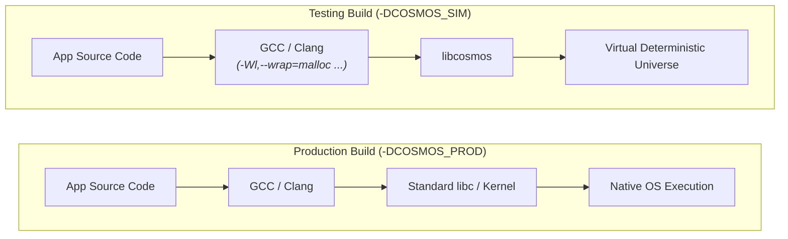
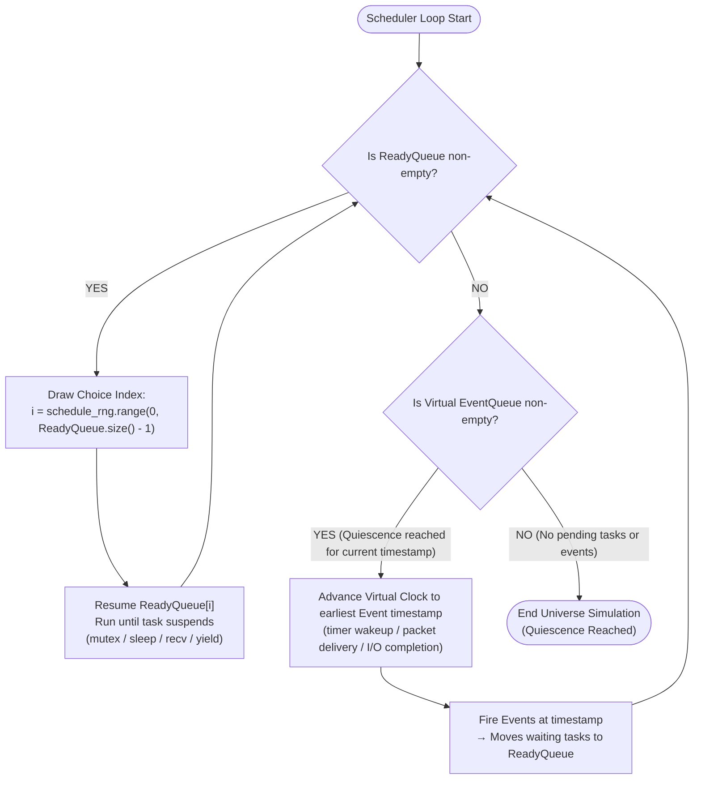

# Cosmos Library: Design & Public API Reference

This is the authoritative design document for `libcosmos`. It defines the architecture, standard POSIX function wrapping taxonomy, public interfaces, and semantics that make simulation runs deterministic and explorable.

---

## Table of Contents

1. [Concepts](#1-concepts)
2. [Build-Flag Swapping & Linker Interposition](#2-build-flag-swapping--linker-interposition)
3. [POSIX Standard Function Taxonomy](#3-posix-standard-function-taxonomy)
4. [Memory Subsystem Reference](#4-memory-subsystem-reference)
5. [Time Subsystem Reference](#5-time-subsystem-reference)
6. [Network Subsystem Reference](#6-network-subsystem-reference)
7. [Randomness Subsystem Reference](#7-randomness-subsystem-reference)
8. [Storage Subsystem Reference](#8-storage-subsystem-reference)
9. [Fault Injection Framework](#9-fault-injection-framework)
10. [Task & Concurrency API & Deterministic Scheduling](#10-task--concurrency-api--deterministic-scheduling)
11. [Data Generators (`gen.hpp`)](#11-data-generators-genhpp)
12. [Assertions (`assert.hpp`)](#12-assertions-asserthpp)
13. [Campaign Engine (`campaign.hpp`)](#13-campaign-engine-campaignhpp)
14. [The Determinism Contract](#14-the-determinism-contract)
15. [Error Handling & Tracing](#15-error-handling--tracing)
16. [Non-Goals (v1)](#16-non-goals-v1)

---

## 1. Concepts

| Term | Meaning |
|---|---|
| **Universe** | One `Simulator` instance running one seeded execution. |
| **Seed** | 64-bit seed value; fully determines a universe (same binary + seed ⇒ identical execution). |
| **Linker Wrapping** | GCC/Clang `-Wl,--wrap=symbol` mechanism that intercepts standard C/POSIX function calls and routes them to `libcosmos`. |
| **RNG Stream** | Independent deterministic PRNG stream derived from the master seed by domain: `schedule`, `fault`, `workload`, `user`. |
| **Task** | A user-space green thread / fiber task cooperatively scheduled by the universe. |
| **Node** | A simulated virtual machine/container: an ownership group for endpoints, memory, and tasks. |
| **Virtual Time** | `Time` (int64 nanoseconds since universe start). Advances only when no task is runnable, to the next event. |
| **Finding** | A violated `always` assertion (or crash) in some universe, or a `sometimes` assertion hit in **no** universe of a campaign. |
| **Campaign** | N universes over N seeds, run in parallel across CPU cores, aggregating findings and printing repro seeds. |

---

## 2. Build-Flag Swapping & Linker Interposition

Cosmos allows applications to be written using **100% standard POSIX C/C++ function calls**. Swapping between production and testing builds occurs at compile/link time:



### Build Configuration Matrix

| Build Flag | Linker Flags | Interposition Target | Runtime Backend |
|---|---|---|---|
| `-DCOSMOS_PROD` | None | Direct system calls | Real OS (`libc`, Linux kernel sockets) |
| `-DCOSMOS_SIM` | `-Wl,--wrap=malloc -Wl,--wrap=free -Wl,--wrap=pthread_create -Wl,--wrap=clock_gettime -Wl,--wrap=socket -Wl,--wrap=send -Wl,--wrap=recv -Wl,--wrap=write -Wl,--wrap=fsync -Wl,--wrap=getrandom` | `__wrap_*` functions | `libcosmos` (Static Library) |

---

## 3. POSIX Standard Function Taxonomy

The following table lists every standard POSIX function intercepted by `libcosmos` in testing builds:

| Category | Standard POSIX Function | Wrapped Symbol | Sim Mode Behavior |
|---|---|---|---|
| **Memory** | `malloc(size)` | `__wrap_malloc` | Allocates from tracked sim heap; checks OOM fault injection |
| | `free(ptr)` | `__wrap_free` | Deallocates from tracked sim heap; detects double-free bugs |
| | `calloc(nmemb, size)` | `__wrap_calloc` | Zero-initialized sim heap allocation |
| | `realloc(ptr, size)` | `__wrap_realloc` | Resizes tracked sim heap allocation |
| **Time** | `clock_gettime(clk_id, tp)`| `__wrap_clock_gettime` | Writes current virtual simulation time into `timespec` |
| | `gettimeofday(tv, tz)` | `__wrap_gettimeofday` | Writes current virtual simulation time into `timeval` |
| | `nanosleep(req, rem)` | `__wrap_nanosleep` | Suspends caller until virtual time reaches `now + req` |
| | `clock_nanosleep(clk, flags, req, rem)` | `__wrap_clock_nanosleep` | Suspends caller until `now + req`, or until `req` as an absolute deadline under `TIMER_ABSTIME` |
| **Network**| `socket(domain, type, p)` | `__wrap_socket` | Returns virtual socket descriptor bound to active Node |
| | `bind(fd, addr, len)` | `__wrap_bind` | Binds virtual socket descriptor to virtual port |
| | `listen(fd, backlog)` | `__wrap_listen` | Marks virtual socket descriptor as passive listener |
| | `accept(fd, addr, len)` | `__wrap_accept` | Blocks until incoming connection event arrives |
| | `connect(fd, addr, len)` | `__wrap_connect` | Initiates virtual connection event across sim network graph |
| | `send(fd, buf, len, flags)`| `__wrap_send` | Injects packet into sim network with latency/loss/reorder faults |
| | `recv(fd, buf, len, flags)`| `__wrap_recv` | Suspends caller until virtual packet delivery event arrives |
| | `close(fd)` | `__wrap_close` | Closes virtual socket descriptor / frees endpoint |
| **Storage**| `open(path, flags, mode)` | `__wrap_open` | Opens virtual file descriptor in sim disk subsystem |
| | `read(fd, buf, count)` | `__wrap_read` | Reads data from virtual page cache / disk image |
| | `write(fd, buf, count)` | `__wrap_write` | Appends dirty bytes to un-synced virtual page cache |
| | `fsync(fd)` | `__wrap_fsync` | Flushes un-synced page cache bytes to durable virtual storage |
| **Random** | `getrandom(buf, len, fl)` | `__wrap_getrandom` | Fills buffer with bytes from seeded `xoshiro256**` stream |
| | `random()` | `__wrap_random` | Returns a draw from the seeded `User` RNG stream |
| | `rand()` | `__wrap_rand` | Returns a draw from the seeded `User` RNG stream (shared with `random()`) |
| | `srandom(seed)`, `srand(seed)` | `__wrap_srandom`, `__wrap_srand` | Deterministic no-ops; host seeding never perturbs the `User` stream |
| **Threads / Sync** | `pthread_create(thread, attr, fn, arg)` | `__wrap_pthread_create` | Spawns green thread / fiber task in sim scheduler (no OS thread) |
| | `pthread_join(thread, retval)` | `__wrap_pthread_join` | Suspends current task until target green thread completes |
| | `pthread_mutex_lock(mutex)` | `__wrap_pthread_mutex_lock` | Locks sim mutex; suspends task on mutex wait queue if contested |
| | `pthread_mutex_unlock(mutex)` | `__wrap_pthread_mutex_unlock` | Unlocks sim mutex; unblocks waiting tasks to Ready Queue |
| | `pthread_cond_wait(cond, mutex)` | `__wrap_pthread_cond_wait` | Unlocks mutex, suspends task on condvar queue, yields to scheduler |
| | `pthread_cond_signal(cond)` | `__wrap_pthread_cond_signal` | Unblocks task waiting on condvar back to Ready Queue |
| | `sched_yield()` | `__wrap_sched_yield` | Yields current task to sim scheduler choice draw |

---

## 4. Memory Subsystem Reference

In testing builds (`-DCOSMOS_SIM`), `__wrap_malloc` and `__wrap_free` intercept heap operations:

- **OOM Fault Injection**: `__wrap_malloc`, `__wrap_calloc` and `__wrap_realloc` each ask the fault injector for one decision per eligible call (`FaultClass::Memory`, `SiteId::malloc` / `calloc` / `realloc`) and translate `OutOfMemory` to `nullptr` plus `errno = ENOMEM`. The decision happens before the heap is touched, so a fired OOM leaves `TrackedHeap` untouched and a failed `realloc` leaves the original block valid. Rates, budgets, windows and occurrence triggers come from the `FaultConfig` installed with `Simulator::install_faults` (`docs/fault-injection.md` §12). Eligibility: a `calloc` size-product overflow is a real API failure answered before the injector, `realloc(ptr, 0)` is a free, and a block this universe does not own is never faulted — none of the three consumes a draw. `malloc(0)` *is* eligible, since returning `nullptr` there is a legal C11 result.
- **Leak Detection**: When a universe completes, `Simulator` automatically verifies that `active_allocations() == 0`. Unfreed pointers are logged as findings with allocation backtraces and repro seeds.

---

## 5. Time Subsystem Reference

In testing builds, virtual time advances deterministically:

- **Virtual Clock Advancement**: Virtual time does **not** advance during CPU computation. It advances instantaneously to the next scheduled event timestamp when all tasks suspend.

---

## 6. Network Subsystem Reference

In testing builds, network calls route through an in-process simulated topology:

```cpp
class Net {
public:
    // Endpoints remember the node that created them; splits are between node groups.
    void partition(const NodeSet& a, const NodeSet& b);
    void heal_partition(const NodeSet& a, const NodeSet& b);
    void heal_all_partitions();
    void crash_node(NodeId node);
};
```

### Delivery Semantics:
1. `send()` consults the partition map, then applies the call-level `Network` outcomes
   (`PacketDrop`, `PacketDelay`, `PacketReorder`, `PacketCorrupt`, `ShortSend`).
2. A cross-partition packet is dropped: `send` reports success, as a kernel buffer would, and the
   peer never sees it. A cross-partition `connect` is refused.
3. Node crash closes the node's endpoints and wakes blocked `recv`/`poll` with the close.
4. `heal` clears the split and wakes blocked calls; no packet is replayed.

---

## 7. Randomness Subsystem Reference

```cpp
class Rng {
public:
    explicit Rng(uint64_t seed);
    static Rng derive(const Rng& parent, uint64_t domain);

    uint64_t next();
    uint64_t range(uint64_t lo, uint64_t hi);
    bool     coin(double p);
    double   uniform();
};
```

RNG stream domains: `Schedule=1`, `Fault=2`, `Workload=3`, `User=4`, `Swarm=5`. Splitmix64 stream derivation ensures independent exploration dimensions across seeds; workload generation reads only the `Workload` stream, so fault/schedule/swarm draws cannot shift its values.

---

## 8. Storage Subsystem Reference

**Point faults.** `__wrap_open/read/write/fsync` ask the fault injector for one
decision per eligible call and translate it to a legal result — `EIO`/`ENOSPC` failures, or a
`ShortWrite` that performs a *real* partial transfer of `count / 2` bytes (write() reporting k
bytes must mean k bytes were transferred; claiming a short count without transferring would be
an impossible world). Decisions happen before the real call, so a faulted call has no side
effects. Eligibility: standard stream fds (0/1/2) and zero-length transfers never reach the
injector — logging must not consume Storage-stream draws, and no outcome is observable on an
empty transfer — so `fire_on_eligible_call` on `SiteId::write` counts only writes of
`count >= 1` to fds `>= 3`. 1-byte writes stay eligible: they can legally fail with
`EIO`/`ENOSPC` (a single-byte WAL commit marker is a real shape); the one degenerate case is a
fired `ShortWrite` on a 1-byte write, which has no legal short observable and observably
degrades to a complete write.

**Durability model.** `StorageModel` simulates page-cache buffering, `fsync` durability, and
torn writes without moving bytes out of the host file:

- `write()` buffers its bytes as un-synced and remembers the pre-image it overwrote; `fsync()`
  is the durability boundary that drops those records and remembers the committed range.
- `StorageModel` covers the surface `write`, `__write_chk`, `pwrite`, `writev`, `pwritev`,
  `fsync` and `fdatasync`, plus application `ftruncate` as a durability event
  (`record_truncate`).
- `Simulator::crash_node` marks the node down and closes its endpoints (peers observe the close).
  It cannot preempt its fibers: they keep running until their next blocked or wrapped call fails on
  a closed endpoint, and storage writes are not refused. Treat a crashed node as not running in the
  harness; that is the same cooperative limitation as `PauseNode`.
- A file belongs to its last writer: `record_write` re-attributes it to the calling fiber's node, so
  `Simulator::reboot_node` discards exactly the un-synced bytes that node wrote. Sharing one fd
  between nodes is unsupported beyond that rule.
- `Simulator::reboot_node` discards the node's un-synced bytes and rolls each file back to its
  durable size, in reverse write order.
- A torn reboot zeroes the last `min(512, last-written)` bytes of the last synced range.
  Whether it tears is one `decide_event(FaultClass::Storage, SiteId::torn_write)` decision,
  with `FaultKind::TornWrite` the only legal outcome.
- Bytes stay in the host file throughout, so `lseek` and `ftruncate` keep native semantics;
  the model only remembers what to put back.
- `StorageModel::set_active_node` attributes each open to a node, so a reboot rolls back only
  that node's files.
- Memory is bounded by `StorageModel::kMaxTrackedBytes` of pre-image bytes; a file that outgrows
  it stops being discard-tracked and `StorageModel::degraded()` reports the gap.

A `TornWrite` goes beyond the fsync contract. It models a device that acknowledged `fsync`
before the sector reached the media — a lying write cache, or a power loss that drops volatile
cache the syscall already reported committed. That is legal at the syscall boundary (the call
returned 0) and impossible for a well-behaved device, and it is the reason a store's CRC check
exists. It is the one outcome that outlives what `fsync` promised, so a campaign that observes
it must read it as the modelled hardware lie, not as an ordinary crash.

---

## 9. Fault Injection Framework

Configuration is `FaultConfig` (`docs/fault-injection.md` §12): per-class enable bits, per-site
activation, and a per-site `FaultRule` carrying rate, `skip_first`, `max_injections`, a weighted
outcome table and an optional occurrence trigger. It is installed once per universe with
`Simulator::install_faults(cfg, node_count)`, which derives the injector's seed from the `Fault`
stream domain (Rule 1) and binds it to that universe's clock.

```cpp
FaultConfig cfg;
cfg.enable_class(FaultClass::Memory);
cfg.activate_site(SiteId::malloc);

FaultRule oom;
oom.rate = 0.001;
oom.outcomes.add(FaultKind::OutOfMemory, 1.0);
cfg.set_rule(SiteId::malloc, oom);

sim.install_faults(std::move(cfg));
```

**Swarm sampling (P4).** A campaign does not hand-write that config per universe; it samples one:
`FaultConfig::sample(sim.swarm_rng())` — or `sample(sim.swarm_rng(), knob_specs)` when the application
declares tunables — draws which classes are enabled, which sites are activated, each rule's rate,
weights and magnitude, and the knob values from the universe's `Swarm` stream (`docs/fault-injection.md`
§6.4). Class and site dimensions that are off are still drawn, on their own sub-streams, so toggling
one class cannot shift another's rate (Rule 8). Knob delivery is the harness's half of §4.3's
boundary: `with_knob_env(cfg, specs, body)` sets each declared knob in the environment, runs the body,
and puts the environment back.

Four composable fault mechanisms:
1. **Declarative Config**: rates applied automatically via the `fault` RNG stream.
2. **Imperative Scripting**: `Simulator::crash_node/reboot_node` are the raw state flips; the
   injector's `crash_node(node, duration)` and `start_partition(a, b, duration)` are the
   limit-checked episodes, with `heal(id)` / `heal_all()`. Every episode schedules its own heal.
3. **Scheduled Faults**: `Simulator::at(when, fn, context)` arms a virtual-time callback, and
   `FaultConfig::scheduled_episodes` is armed at install (crashes, pauses, partitions).
4. **Custom Verdict Hooks**: `sim.net().on_send` — not delivered; partitions and call-level
   outcomes cover the shipped surface.

---

## 10. Task & Concurrency API & Deterministic Scheduling

Cosmos supports standard POSIX `pthread` concurrency in application code with zero code modification (`pthread_create`, `pthread_join`, `pthread_mutex_*`, `pthread_cond_*`).

### How `pthread` Interposition Works (`-Wl,--wrap=pthread_create`)

In testing builds (`-DCOSMOS_SIM`), **no OS threads are created**. The entire simulation universe executes inside a single physical OS thread. Standard `pthread` calls are mapped to user-space green threads / fibers managed by Cosmos's single-threaded scheduler:

- **`__wrap_pthread_create(thread, attr, start_routine, arg)`**: Allocates a user-space task frame (green thread), pushes it to the scheduler's `ReadyQueue`, and assigns a virtual thread ID.
- **`__wrap_pthread_mutex_lock(mutex)`**: If the virtual mutex is free, acquires it immediately. If locked, moves the current task from `ReadyQueue` to the mutex's `WaitQueue` and yields execution to the scheduler.
- **`__wrap_pthread_mutex_unlock(mutex)`**: Releases the virtual mutex, moves waiting tasks from `WaitQueue` back to `ReadyQueue`, and yields to the scheduler choice point.
- **`__wrap_pthread_cond_wait(cond, mutex)`**: Atomically releases the mutex, moves the current task to the condition variable's `WaitQueue`, and yields control to the scheduler.
- **`__wrap_pthread_cond_signal(cond)`**: Unblocks one or all tasks from the condition variable queue, returning them to the `ReadyQueue`.

### Deterministic Scheduler Loop Algorithm

Every context switch decision is driven by the seeded `schedule` RNG stream:



### Why Determinism Holds under `pthread` Wrapping:
1. **Single-Threaded Execution**: Eliminates OS kernel thread preemption, CPU core cache line races, and hardware interrupt timing jitter.
2. **Seeded Choice Draws**: When multiple tasks are runnable, `schedule_rng` chooses which task runs next. A specific seed reproduces the **exact same sequence of thread interleavings**.
3. **Exploration**: Different seeds explore different valid interleavings, exposing race conditions, deadlocks, and missed condition signals.

---

## 11. Data Generators (`gen.hpp`)

Property-testing-style generators drawing from the `workload` RNG stream. The stream is owned by
the universe (`Simulator::workload_rng()`), so generated values are a pure function of the seed and
are isolated from fault, schedule, and application `getrandom` draws:

```cpp
namespace cosmos::gen {
    template<std::integral T> T range(Rng&, T lo, T hi);   // inclusive, signed or unsigned
    uint64_t range(Rng&, uint64_t lo, uint64_t hi);         // mixed-width arguments
    std::size_t index(Rng&, std::size_t n);                 // [0, n)
    bool     coin(Rng&, double p);
    template<std::ranges::random_access_range R>
    std::ranges::range_value_t<R> one_of(Rng&, const R&);   // array, vector, span
    template<typename T> T one_of(Rng&, std::initializer_list<T>);
    void     fill_string(Rng&, std::span<char>, std::string_view alphabet = kDefaultAlphabet);
    inline constexpr std::string_view kDefaultAlphabet;
    std::string string(Rng&, std::size_t len, std::string_view alphabet = kDefaultAlphabet);
    // string(Rng&, len, char) is deleted: a scalar is not an alphabet.
    std::string string(Rng&, std::size_t min_len, std::size_t max_len,
                       std::string_view alphabet = kDefaultAlphabet);
    void     bytes(Rng&, std::span<std::byte>);
    Duration exponential(Rng&, Duration mean);
    template<std::ranges::random_access_range R> void shuffle(Rng&, R&);
    template<typename T> T weighted_one_of(Rng&, std::initializer_list<std::pair<T, double>>);
}
```

`fill_string` and `bytes` write into caller-owned storage and never allocate. An empty alphabet is
total in release: it fills NUL bytes and consumes no draws. `bytes` copies in host byte order, so
one seed is byte-identical per architecture but not across endianness. Use the fill forms when a
test pins an exact eligible-call index at `SiteId::malloc`: an owning `gen::string` spends wrapped
allocations of its own. `exponential` uses `libm`, so one binary reproduces exactly; cross-libm
bit-identity is not promised, and a draw beyond `int64` nanoseconds saturates to `Duration::max()`.

### 11.1 Workload delivery adapters

The generators only produce values. The application interface is application-specific, so the
harness defines the operation shape and the adapter that delivers it:

```cpp
struct Put { std::string key, value; };
struct Get { std::string key; };
using Op = std::variant<Put, Get>;

Op next_op(cosmos::Rng&);                 // gen::* fills the fields
void apply(App&, const Op&);              // direct API, or serialize onto a transport
```

Three delivery paths are supported today:

- **Direct API (recommended):** the app is linked into the simulation binary (`COSMOS_*_NO_MAIN`)
  and `apply` calls its public functions. This is the shape `tests/test_broken_app.cpp` uses.
- **REST/HTTP over virtual sockets:** the app's server runs as a fiber in the same universe; the
  workload driver runs on the main fiber (or a fiber of its own). `include/cosmos/http.hpp`
  supplies a minimal HTTP/1.1 client (`http::get`, `http::put`, `http::post`, `http::exchange`)
  over the wrapped `send`/`recv`. It sends one request per connection and therefore requires
  `Connection: close` (caller-supplied keep-alive is rejected). It supports Content-Length-framed
  responses and EOF-framed responses, rejects transfer codings it cannot decode (including
  chunked), rejects ambiguous framing such as duplicate `Content-Length`, and bounds head/body
  accumulation.
  `http::exchange` allocates through the wrapped heap in static-libstdc++ builds, so it shifts
  `SiteId::malloc` eligible-call indices just like `gen::string`; use a direct-API adapter when a
  test pins an exact malloc index. Under Memory fault injection those owning allocations can also
  throw `std::bad_alloc`, so use the fill forms and direct-API adapter for OOM tests.
  `tests/test_workload.cpp` runs a generated REST workload against an in-process KV server and
  covers the client's rejection paths.
- **stdin:** `Simulator::set_stdin(std::string_view)` installs a deterministic byte buffer;
  subsequent `read(0, ...)` calls serve it with POSIX partial-read semantics and EOF. A buffer
  installed with `set_stdin("")` means EOF; `clear_stdin()` uninstalls the buffer and returns fd 0
  to the host, so an application that never opts in keeps its normal stdin. A successful
  `close(0)`, or an `open()`/`open64()`/`__open_2`/`__open64_2` that returns fd 0, releases
  harness ownership (a close that reports `EBADF` also releases it, because no fd 0 remains).
  The descriptor identity (`fstat(0)`'s `dev`/`ino` and file type) is captured by `set_stdin()`
  and re-checked on every harness read: an `openat`/`creat`/`dup2`/`fclose` replacement of fd 0 is
  detected and reads fall through to the host, even though `stdin_owned()` remains true. If fd 0
  is closed when `set_stdin()` is called, the harness cannot serve it and reads return the host's
  `EBADF`. `poll`/`__poll_chk` route a harness-owned fd 0 to the transport, which reports it always
  readable (the buffer is data or EOF) rather than consulting the host descriptor; a readiness wait
  on the simulated stdin can therefore never park the universe's only OS thread. `select` and
  `epoll_wait` are not wrapped and keep observing the host descriptor. `readv`,
  `pread`, and `lseek(0, ...)` are not intercepted; a seek acts on the host descriptor while reads
  serve the harness buffer. fd 0 is process-global, while ownership is per universe, so closing it
  in one universe does not clear another universe's flag. The minimum wraps are `read`,
  `__read_chk`, `close`, and the `open`/`open64`/`__open_2`/`__open64_2` family; without them the
  application sees its normal stdin. `fread`/`std::cin` and other paths that use libc internals
  outside `--wrap=read` are not intercepted, so prefer a passed fd/buffer or a direct parser entry
  point for those.

An application that is a separate process is outside the interposition boundary: `--wrap` only
rewrites references in the simulation binary. A REST/websocket server must therefore be built as a
library and linked in, with its socket calls interposed. A prebuilt shared library that calls
`send` internally bypasses the wrappers for the same reason shared `libstdc++` bypasses the malloc
wrapper.

---

## 12. Assertions (`assert.hpp`)

```cpp
namespace cosmos {
    void always(bool cond, std::string id, std::string detail = "");
    void sometimes(bool cond, std::string id);
    inline void reachable(std::string id) { sometimes(true, id); }
}

#define COSMOS_CHECK(cond, id) ::cosmos::always((cond), (id), \
        std::string(__FILE__) + ":" + std::to_string(__LINE__))
```

- `always`: Invariant property evaluated per universe. Violation = immediate finding.
- `sometimes`: Liveness/coverage property evaluated across all universes in a campaign. Must be hit at least once.

---

## 13. Campaign Engine (`campaign.hpp`)

The declarations below are the shipped surface. Three of them differ from the sketch this section
originally carried, each for a reason recorded here rather than left as drift:

- **`build_fn` returns a `ScenarioReport`.** It was `void`. A `void` return makes the findings
  unreachable: the report lives in the Scenario the callee owns, and the campaign has no other
  channel. §17.3's call shape is unchanged.
- **`Failure` is `Finding`.** `Failure` was declared here and defined nowhere; the glossary (§1) and
  §15 both call it a Finding.
- **A universe runs in a worker process, not in the caller's.** That is what makes a crash a finding
  instead of a dead campaign. The consequence is deliberate and load-bearing: writes to captured
  variables inside `build_fn` are **not** visible after `run` returns, and its returned
  `ScenarioReport` is the only channel back. Use `Scenario::on(sim, plan)` (not
  `Scenario::create`) so the campaign's own Simulator is the one that runs.

```cpp
struct CampaignConfig {
    uint64_t trials    = 1000;
    uint64_t base_seed = 0;
    unsigned parallel  = std::thread::hardware_concurrency();
    uint32_t node_count = 1;
    bool     verify    = false;   // runs each universe twice; report + trace hash must agree
    uint64_t trace_capacity = kDefaultTraceCapacity;  // verify only; overflow is reported
    std::string program;          // named in the repro line, e.g. "myapp_test"
};

struct Finding {
    std::string id;               // the assertion id -- the dedup key, never the fault set
    uint64_t    index, seed;      // (base_seed, index) and the universe seed it derives
    std::string detail, ledger;   // from the first universe that failed this id
    Time        at{};
    uint64_t    universes_failed;
    bool        rare;             // reproduces in under a third of the runs
};

struct CampaignReport {
    uint64_t runs, failed_runs, crashed_runs;
    bool     refused;             // the harness declined to run; findings hold the reason
    std::vector<Finding>     findings;   // sorted by id, so parallel == sequential exactly
    std::vector<std::string> never_hit;  // its own section, never a flag on a finding
    SiteCounterMap activated_runs, eligible_calls, injections;  // per site, summed over universes
    std::vector<VacuousSite> vacuous;    // §11.4: sites nothing exercised, with the reason
    uint64_t out_of_scope_assertions;
    uint64_t base_seed;
    std::string program;
    bool     verify;              // echoed: the double-run check ran
};

class Campaign {
public:
    static CampaignReport run(const CampaignConfig&, const UniverseFn& build_fn);
};
```

`print_campaign_report` renders §17.4's shape plus the repro line; `print_campaign_json` emits the
machine-readable form the P4 exit gate asks for — findings, `never_hit` in its own group, the
`vacuous` sites in another, per-site `activated`/`eligible`/`fired` counters and repro seeds — so a
dashboard consumes the report rather than being a feature to build. Whether a configuration did any
work is answered by the counters, not by reading a log: `fault_was_injected(report.injections,
FaultClass::Storage)` for the class-level question, and `report.vacuous` for the site-level one.

**`verify` is the double-run check.** Each universe runs twice from the same seed with tracing on,
in the same worker process — deliberate, because the hidden global state it exists to catch only
shows up that way. Two things are compared: the full `ScenarioReport` (checks, coverage notes,
per-site counters, `activated_sites`, `active_allocations`, `ledger_dump`) and the canonical trace
hash. A mismatch becomes one `cosmos.campaign.verify` finding whose detail names the first differing
field, so the diagnosis is a field rather than a bit. Identical throws are deterministic and keep
their own `cosmos.campaign.threw` finding; a signal kills the worker and is handled by the existing
crash path. Tracing is turned on by the campaign through `Simulator::set_default_trace_options`, so a
body that installs its plan with `Scenario::on(sim, plan)` needs no change; a body that bypasses the
campaign Simulator is reported as "tracing was not enabled". The one up-front refusal left is
`verify` with `trace_capacity == 0`, which cannot record anything to hash.

---

## 13.1 Minimization (`minimize.hpp`)

`minimize()` is trace-first, not seed-first: the caller records the failing universe (the trace is
the regenerable artifact, per `SPRINT_PLAN.md` §P5) and passes it in with the body half of a
universe. A replay cannot be driven through `UniverseFn`: that shape constructs its own Scenario via
`Scenario::on`, and the replay injector must be installed by `Scenario::replay`.

```cpp
using ScenarioBody = std::function<void(Scenario&)>; // run, quiesce, check; no Scenario of its own

struct MinimizeConfig {
    FaultConfig plan;       // the failing run's plan; replay needs the same gate verdicts
    std::string finding_id; // the check that must keep failing
    uint32_t node_count = 1;
    std::string program;    // named in the repro line
};

MinimizeReport minimize(const FaultTrace& source, const MinimizeConfig&, const ScenarioBody&);
void print_minimize_report(std::ostream&, const MinimizeReport&);
```

The loop is greedy one-at-a-time suppression over the trace's fires (`outcome != None`): dropping a
fault that still reproduces is permanent, and full passes repeat until one drops nothing. That
final pass *is* the 1-minimal guarantee — every survivor was last tested against the other
survivors alone and the finding survived only without it. Global (ddmin) minimality is out of scope,
and the report says `1-minimal`, never `minimal`.

Each trial is a `Scenario::replay` in a forked child, so a crash, a throw, or an exit without a
report is read as "not reproduction" — the entry is essential — rather than ending the reduction. A
crash is a different finding id, and keeping a fault because removing it turns a check failure into
a crash would keep noise in the minimal set. Before any reduction, one baseline replay with
everything honoured must still reproduce the named finding; otherwise the minimizer refuses rather
than returning a meaningless set. A truncated trace, a harness finding id (`cosmos.*`), a trace that
is itself a replay, and a call from inside a live universe are refused for the same reason.

No binary ships. `--minimize` and `--only-faults=` are the harness's flags, and the printer emits
the exact decision seqs the harness passes to `TraceFilter::only_faults`.

---

## 13.2 Canonical encoding (`trace.hpp`)

```cpp
inline constexpr uint8_t kTraceSource   = 1;   // ledger = 2 reserved
inline constexpr size_t  kTraceHeaderBytes = 17;
inline constexpr size_t  kTraceEntryBytes  = 43;

enum class TraceError : uint8_t { Truncated, BadSource, BadValue, TrailingBytes };

std::string encode_trace(const FaultTrace&);
std::expected<FaultTrace, TraceError> decode_trace(std::string_view bytes);
uint64_t trace_hash(const FaultTrace&);        // FNV-1a 64 over the encoding
```

The bytes are canonical, not the struct: fixed width, declared entry order, little-endian, no
padding. Header is `u8 source`, `u64 count`, `u64 universe_seed`; each entry is
`seq u64 · eligible_index u64 · at.ns i64 · site u64 · amount.ns i64 · outcome u8 · drew u8 ·
status u8`. `sizeof(TraceEntry)` is 48 while the encoding is 43, and `static_assert`s pin both the
field widths and that gap, so a struct layout change can never silently alter the hash. Capacity is
buffer size, not schedule, and is not encoded — a decoded trace gets `max(count, 1)`; `dropped` is
not encoded either, because a truncated trace is not a valid canonical input (`decode_trace` cannot
recover what was never written, and `--verify` reports overflow instead of hashing a prefix).
FNV-1a 64 uses offset basis `14695981039346656037` and prime `1099511628211`.

---

## 13.3 Exploration (`coverage.hpp`, `snapshot.hpp`, `exploration.hpp`)

Level 2 coverage is a fixed 64 KiB bitmap filled by sanitizer callbacks. Clang uses
`trace-pc-guard`; GCC uses `trace-pc` with a normalized return address. `coverage_reset()` precedes
a universe body and `coverage_snapshot()` copies the map after it. `CampaignConfig::guidance =
SeedGuidance::Coverage` retains novel seeds in a bounded corpus and derives later seeds from it.
Coverage never enters the canonical trace or `trace_hash`.

Level 3 snapshots are fork-COW checkpoints (`Snapshot::capture()`), not serialized in-process
images. The checkpoint captures the heap, fiber stacks, scheduler queues, RNGs and network queues
through fork; tracked host files and descriptor offsets are copied explicitly. `explore()` asks
the checkpoint for a branch child, optionally forcing the next scheduler choice. `SimSubstrate`
implements the `ISubstrate` seam. `exploration.json` is additive observation data and is not a
replay or minimization input.

## 14. The Determinism Contract

Under `libcosmos`, determinism holds provided that application code:
1. Accesses time only via POSIX time functions (`clock_gettime`) or `sim.now()`.
2. Draws randomness only via POSIX random functions (`getrandom`) or `sim.rng()`.
3. Performs I/O only via POSIX socket/file calls.
4. Avoids iteration dependencies on raw pointer addresses (ASLR leaks).

---

## 15. Error Handling & Tracing

- Findings output a clear repro command: `myapp_test --seed 12345`.
- After minimization the repro names the kept decision seqs: `myapp_test --seed 12345
  --only-faults=17,42`.
- Tracing sink records FNV-1a event hash (`trace_hash`) used by `--verify` double-run validation.

---

## 16. Non-Goals (v1)

- Multi-process universes inside a single simulation trial (handled in Phase 7 via `KvmSubstrate`).
- Real OS thread preemption inside a simulation universe (simulations run single-threaded and cooperative for perfect reproducibility).
