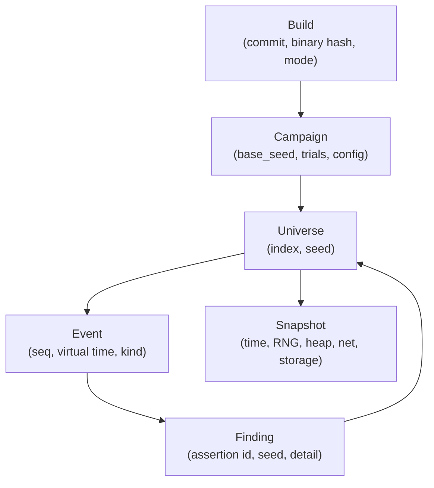

# Cosmos: UI/UX Design for Simulation Control and Inspection

Status: **Phases 1–3 implemented.** The v1 artifact contract, exporter, checked-in fixture and
read-only dashboard exist (`include/cosmos/export.hpp`, `include/cosmos/minimize_json.hpp`,
`tools/ui_export.cpp`, `ui/fixtures/demo/`, `ui/web/`, `ui/server/serve.py`). The v3 inspection
stream is frozen in `docs/event-stream.md` and `include/cosmos/event_sink.hpp`, with scheduler,
network, storage, memory, clock, random, application and node producers attached (U3.2), a
read-only state inspector (U3.3), a single-universe breakpoint inspector with a recorded command
log (U3.4), and an application telemetry API (U3.5). This document describes the data a Cosmos UI
can expose, the screens worth building, and the constraints determinism places on control.

> **Resuming this work?** Read [Appendix A](#appendix-a-multi-session-implementation-context)
> before writing code. It records the current state, frozen decisions, data-contract gaps,
> session-sized tasks, and the end-of-session handoff checklist. Update it at the end of every
> session.

This is not a UI for watching a simulation the way one watches a game. A campaign can execute
thousands of universes per second, and most of those universes are uninteresting. The UI's job is
to help an engineer:

1. **Search** a large space of executions.
2. **Recognise** the few universes that went wrong.
3. **Explain** exactly why one of them went wrong.
4. **Reduce** the explanation to the faults that actually mattered.
5. **Re-run** it, compare it, or branch it.

The central design consequence: Cosmos should have **two linked modes**, not one dashboard.

- **Campaign cockpit** — many universes, aggregate data, fast triage.
- **Replay microscope** — one universe, full timeline, state inspection, time travel.

The bridge between them is a **finding**. A finding is the object the user clicks when they move
from "something is wrong somewhere" to "this is the causal story."

---

## Table of Contents

1. [Design Thesis](#1-design-thesis)
2. [Entity Model](#2-entity-model)
3. [What Data Can Be Represented](#3-what-data-can-be-represented)
4. [Data Availability Tiers](#4-data-availability-tiers)
5. [Information Architecture](#5-information-architecture)
6. [Screens and UX](#6-screens-and-ux)
7. [Signature Flows](#7-signature-flows)
8. [Control Semantics and Determinism](#8-control-semantics-and-determinism)
9. [Visual and Interaction Principles](#9-visual-and-interaction-principles)
10. [Implementation Notes](#10-implementation-notes)
11. [Suggested MVP Sequence](#11-suggested-mvp-sequence)
12. [Non-Goals and Open Questions](#12-non-goals-and-open-questions)
13. [References](#13-references)

Appendices:

- [Appendix A: Multi-Session Implementation Context](#appendix-a-multi-session-implementation-context)
- [Appendix B: Session Log](#appendix-b-session-log)

---

## 1. Design Thesis

### 1.1 Simulation is a search, not a stream

A campaign is not one long simulation. It is `N` independent universes over `N` seeds, with each
universe fully determined by:

```text
(build, FaultConfig, seed) -> execution
```

Because the seed is the identity, the UI should treat a universe as a **document** with a stable
URL, not as a transient process. You can close the tab, reopen the link, and replay the same
universe. You can attach a link to a ticket. You can diff two universes.

### 1.2 Replay is the source of truth

Live simulation state is expensive to inspect and dangerous to mutate. Recorded events are cheap,
stable, and shareable.

- Default UI mode is **read-only playback** of an artifact.
- Live control is a separate, explicit mode.
- Every live intervention must be recorded, or the run must be labelled as no longer reproducible
  from `(build, config, seed)` alone.

### 1.3 The primary time axis is event order, not wall clock

Virtual time is the semantically meaningful clock, but it is event-driven and often jumps. Many
events share the same virtual timestamp (especially at `t=0`), so a purely proportional time axis
collapses thousands of events into one pixel.

The UI should use **event sequence** as the default horizontal axis, annotate it with virtual-time
ticks, and offer a proportional virtual-time view as an alternate mode. Wall-clock time belongs in
performance metadata, never on the simulation timeline.

### 1.4 One bug, many seeds

Findings are deduplicated by assertion ID, not by seed or fault set. A bug that reproduces in
4,000 of 10,000 universes is still one finding. The UI must make prevalence visible without
hiding the individual seeds that prove it.

### 1.5 Vacuity is not a failure, but it is dangerous

A campaign can run 10,000 universes and never inject a storage fault. That is not a finding — it
is a fact about the configuration. The UI must show vacuity prominently and separately, because a
green campaign that tested nothing is worse than a red one that found a real bug.

---

## 2. Entity Model



| Entity | Identity | Lifetime | Primary UI use |
|---|---|---|---|
| **Build** | commit + binary hash + build mode | Release | Provenance, regression history |
| **Campaign** | campaign ID + config hash | One launch | Search, progress, aggregate results |
| **Universe** | `(campaign, index, seed)` | One replayable execution | Investigation unit |
| **Event** | `(universe, seq)` | Immutable record | Timeline, causality, comparison |
| **Finding** | `(campaign, assertion id)` | Aggregated across seeds | Triage, minimization, history |
| **Snapshot** | `(universe, virtual time)` | Restorable state | State inspection, branching |

The code already mirrors most of this model:

- `CampaignReport`, `Finding`, and `VacuousSite` in `include/cosmos/campaign.hpp`
- `ScenarioReport`, `CheckResult`, and `CoverageNote` in `include/cosmos/scenario.hpp`
- `FaultTrace` and `TraceEntry` in `include/cosmos/trace.hpp`
- `FaultLedger` and `LedgerEntry` in `include/cosmos/ledger.hpp`
- `MinimizeReport` in `include/cosmos/minimize.hpp`

---

## 3. What Data Can Be Represented

This section is deliberately exhaustive. A UI does not have to show all of it at once, but the
data model should be able to carry it.

### 3.1 Campaign level

Campaign metadata:

- Campaign ID, display name, start/end wall time.
- Program name and invocation.
- Build identity: git commit, binary hash, build mode (`PROD` or `SIM`), compiler, flags, host.
- `base_seed`, `trials`, `node_count`, `parallel`, `verify`, `trace_capacity`.
- Config hash and the exact config artifact.

Progress and health:

- Universes completed, remaining, and in flight.
- Runs per second, virtual-time throughput, ETA.
- Worker lanes, slice boundaries, current seed per worker.
- Crashes, fork failures, refused campaigns, out-of-scope assertions.
- Per-worker artifact flush status and lost results.

Results:

- `runs`, `failed_runs`, `crashed_runs`.
- Findings grouped by assertion ID.
- `never_hit` properties.
- `vacuous` sites and their reasons.
- Per-site `activated_runs`, `eligible_calls`, `injections`.
- Verify status: double-run agreement, trace hashes, first differing field.
- Repro commands.

The existing `print_campaign_json()` output is the starting contract. As of U0.2 it carries
`Finding::at`, every failing seed, trace metadata and the realized-config identity; per-universe
rows live in `universes.ndjson` (Appendix A.5.1).

### 3.2 Configuration level

The **plan** and the **realized configuration** are different objects and must both be visible.

Plan:

- `FaultMode`: Safety or Liveness.
- Enabled fault classes: Memory, Network, Storage, Clock, Process, Random.
- Activated sites.
- Per-site rules:
  - `rate`
  - `skip_first`
  - `max_injections`
  - outcome table and weights
  - `fire_on_eligible_call` occurrence trigger
- Fault-model limits: `max_crashed_nodes`, `min_healthy_quorum`.
- Scheduled episodes: `at`, crash/partition/pause spec, `until_heal`.
- Knobs: ID, value, legal range, scale, environment variable.
- Lifecycle windows: `warmup_until`, `quiesce_after`.
- Validation result: `ConfigError` plus offending site.

Realized configuration:

- The swarm-sampled config for each universe.
- Which classes were enabled in that universe.
- Which sites were activated.
- Which sampled rates and outcome weights applied.
- Which knob values were chosen.

This distinction is load-bearing: `FaultConfig::sample()` varies configuration per universe from
the `Swarm` stream. A UI that shows only the template lies about what a particular seed actually
ran.

### 3.3 Universe level

Identity and outcome:

- Universe index, seed, base seed.
- Applied config and its hash.
- Status: queued, running, passed, failed, crashed, refused, hung.
- Virtual end time, wall duration, trace hash, verify result.
- Repro command.

Report:

- `no_check_failed`.
- Checks: `id`, `detail`, `passed`, `at`.
- Coverage notes: `id`, `hit`.
- Active allocations at quiesce.
- Per-site eligible/fired counters.
- Activated site set.
- Ledger dump or structured ledger.

Fault injector state:

- Mode, quiescing flag, quiet depth.
- Active episodes and their heal deadlines.
- Decisions and draws consumed.
- Replay cursor, withheld entries.
- Per-site counters.

### 3.4 Timeline level

This is the richest layer. Some of it exists today; some requires instrumentation.

Fault events (available today through `FaultTrace` and `FaultLedger`):

- `seq`
- `eligible_index`
- virtual `at`
- `site`
- `fault_class`
- `outcome`
- `amount`
- `drew`
- `status` (`Fired`, `Skipped`, `Suppressed`)
- skip reason
- persistent flag
- fire index for ledger entries

Scheduler events (needs instrumentation):

- Task spawn, run, block, wake, exit, yield.
- Mutex lock/unlock and contention.
- Cond wait/signal/broadcast.
- Join and detach.
- Timer arming, firing, cancellation.
- Deadlock detection.
- Scheduler choice points and chosen ready task.

Network events (partly available, mostly needs instrumentation):

- Socket creation, bind, listen, connect, accept, close.
- Send and receive calls, flags, requested and transferred bytes.
- Packet enqueue, delivery time, drop, delay, reorder, corruption.
- Endpoint state changes.
- Partition creation and healing.
- Node crash closing endpoints.

Storage events (partly available, needs instrumentation):

- Open, read, write, fsync, fdatasync, pwrite, writev, ftruncate.
- Dirty page-cache bytes.
- Durable boundary.
- Torn sector.
- Rollback on reboot.
- Degraded tracking state.

Memory events (partly available, needs instrumentation):

- Allocation, free, realloc.
- Allocation ID, requested size, active total.
- Canary corruption.
- Leak at end of universe, ideally with backtrace.

Clock and randomness events (needs instrumentation):

- `clock_gettime`, `gettimeofday`.
- Sleeps and timer deadlines.
- Clock steps.
- Random draws by stream.
- User/workload RNG consumption.

Application events (partly available):

- `always()` checks and failures.
- `sometimes()` registration and hits.
- `reachable()` notes.
- Workload requests and responses.
- Custom counters, gauges, spans, and annotations.
- Operator commands and breakpoint hits.

Every timeline event should carry:

```text
universe, seq, virtual_time, wall_time (optional), kind, node, task,
correlation_id, payload
```

`correlation_id` is what makes causality visible: a `send` that becomes a `drop` that becomes a
`recv` timeout is one story, not three unrelated rows.

### 3.5 State level

At a pause point or snapshot, the UI can show:

- Virtual clock, realtime epoch, pending timers and deadlines.
- Node registry: count, live/crashed, paused state.
- Scheduler: ready queue, blocked tasks, current task per node, task states, stacks.
- Network: endpoints, ports, peer links, pending accepts, rx queues, in-flight packets.
- Storage: files, owner node, durable size, unsynced writes, last sync, torn range, tracked bytes.
- Heap: active allocations, sizes, IDs, leaked blocks.
- Fault injector: active episodes, quiet depth, per-class RNG positions, budgets.
- RNG stream tree: master seed → Schedule, Fault, Workload, User, Swarm.
- stdin buffer and ownership state.

`Snapshot` is defined in `docs/architecture.md` as a future capability. Until it exists, the UI can
implement “time travel” by replaying from the seed and fast-forwarding to the requested event.
The UX should hide the implementation difference behind a progress indicator.

### 3.6 Analysis level

Finding analysis:

- Grouping by assertion ID.
- Prevalence (`universes_failed / runs`).
- Rare badge (`rare` is true when a finding reproduces in under a third of runs).
- First seed that failed.
- Causal window: events immediately before the failed check.
- Full ledger.

Minimization:

- Candidate fires.
- Kept fires.
- Passes and replays.
- Crashed trials.
- Exact `--only-faults=` repro.
- The explicit label **“1-minimal, not globally minimal.”**

Comparison:

- Two seeds, two runs, or two builds.
- First divergence by event, virtual time, and report field.
- Config diff.
- Trace hash diff.
- Verify mismatch details.

Exploration (planned in `docs/state-exploration.md`):

- Coverage bitmap and novelty.
- Seed corpus.
- Snapshot branch tree.
- Parent/child branch relationships.
- Choice points where branches diverged.

### 3.7 Application-defined telemetry

Engine data alone is not enough to debug the application under test. A UI should support a small
telemetry API for user code:

- Counters: requests, retries, drops, panic count.
- Gauges: queue depth, commit index, WAL offset, active connections.
- Spans: request → replicate → fsync → ack.
- Annotations: “leader elected,” “WAL replayed,” “client retry.”
- State snapshots: application-specific structured state.

For a replicated KV example, this would show leader/follower role, per-node store contents,
replication lag, and acked-but-unreplicated writes. That is what turns a generic simulation
harness into a useful application debugger.

Payload bytes from network and storage should be redacted by default. Show length, hash, and an
opt-in hexdump.

### 3.8 Build and environment level

- Git commit, branch, dirty state.
- Binary hash.
- Build mode and build flags.
- Compiler and version.
- Host kernel and architecture.
- Campaign start and end time.
- Artifact retention policy.

The build identity matters because a repro is only valid for the exact binary. The UI should
never show a seed without its build.

---

## 4. Data Availability Tiers

The UI can be built in layers, and the layers do not all require engine changes.

| Tier | Data | Status | Effort |
|---|---|---|---|
| **Tier 1** | Campaign report, findings, `never_hit`, vacuity, site counters, checks, coverage notes, fault ledger, fault trace, repro commands | Available now | Frontend + artifact ingestion |
| **Tier 2** | Heap allocation table, scheduler task list, endpoint list, file list, pending packets, per-node state | Public or near-public accessors exist in part | Read-only accessors and serialization |
| **Tier 3** | Full syscall/event stream, snapshots, breakpoints, coverage bitmap, app telemetry | Requires new instrumentation | Engine, protocol, and UI work |

A strong v1 can be built entirely from Tier 1. It would already answer:

- What failed?
- In which seed?
- With what fault ledger?
- Was the campaign vacuous?
- What is the exact repro identity or declared command?

---

## 5. Information Architecture

```text
Campaigns
└── Campaign
    ├── Overview
    ├── Universes
    ├── Findings
    ├── Coverage
    ├── Configuration
    └── Artifacts
└── Universe
    ├── Replay (timeline)
    ├── State
    └── Report
└── Finding
    ├── Summary
    ├── Ledger
    ├── Timeline
    ├── Minimize
    └── History
```

Global navigation:

- **Campaigns** — list, launch, compare.
- **Findings** — cross-campaign triage and history.
- **Builds** — build identity and regressions.
- **Settings** — artifact retention, telemetry sampling, integrations.

Every view should be deep-linkable:

```text
/builds/<hash>/campaigns/<id>/universes/<seed>/events/<seq>
```

---

## 6. Screens and UX

### 6.1 Campaign launcher / scenario composer

Purpose: define the fault model and launch a search.

Layout:

- Left column: the application's promise.
  - Node count.
  - Quorum and liveness deadline.
  - Maximum crashed nodes.
  - Workload/scenario selection.
- Right column: what the injector may do.
  - Enabled classes and sites.
  - Per-site rates and outcome weights.
  - Triggers and scheduled episodes.
  - Knobs and windows.
- Bottom: seed strategy and launch controls.
  - Base seed, trial count, parallel workers.
  - Verify toggle and trace capacity.
  - “Smoke run 10 seeds” and “Launch campaign.”

Important UX details:

- **Live validation.** Show `ConfigError` and the offending site inline. Do not let a config
  reach the engine if the UI can already prove it invalid.
- **Chaos budget.** Summarise the promise and the limits in one sentence: “3 nodes, at most 1
  crashed, at least 2 healthy, safety mode.”
- **Expected work.** Estimate eligible calls, expected fires, and vacuity risk.
- **Swarm preview.** Show the realized config for sample seeds, not just the template.
- **Presets.** Save and share named configurations.

### 6.2 Campaign cockpit

Purpose: monitor the search and triage aggregate results.

```text
+ Campaign #184  build 9f2c1a  * 1,000 seeds * 3 nodes * verify on --- 62% ----+
| 18.4k runs/s   ETA 00:12   findings 3   never-hit 2   vacuous 4   crashed 1 |
+---------------------+-----------------------------------+---------------------+
| FINDINGS            | seed coverage / worker lanes      | COVERAGE            |
| read-your-writes 41%| w0 ####################............| malloc  act 812/812 |
|   rare  seed 0x...  | w1 ####################............| send    act 800/812 |
| split-brain       1%| w2 ###################.............| write   act 400/812 |
+---------------------+-----------------------------------+---------------------+
```

Panels:

- **Findings** grouped by assertion ID, sorted by prevalence or recency.
- **Never hit** properties, visually distinct from findings.
- **Vacuous sites** with reason tokens and recommended actions.
- **Worker lanes** showing slice, current seed, and progress.
- **Throughput and ETA**.
- **Verify status** for double-run campaigns.

Actions:

- Pause intake of new universes.
- Stop the campaign.
- Re-run failed seeds only.
- Open a universe.
- Copy a repro command.
- Export artifacts.

“Pause” should stop scheduling new universes; it should not freeze an in-flight universe unless
the user explicitly opens an interactive replay process.

### 6.3 Universe explorer

Purpose: find the right universe among thousands.

```text
+ index | seed | status | vt end | wall | checks | faults | heap | leak | hash | verify +
| 42    | 0x.. | FAILED | 61ms   | 8ms  | 1      | 47     | 12MB | 0    | a1b2 | ok     |
| 43    | 0x.. | PASS   | 44ms   | 6ms  | 0      | 12     | 8MB  | 0    | c3d4 | ok     |
+-------------------------------------------------------------------------------------+
```

Filters:

- Status.
- Finding ID.
- Fault class or site fired.
- Node count.
- Rare findings.
- Trace hash mismatch.
- Seed range or universe index range.

Actions:

- Open replay.
- Compare two or more universes.
- Copy seed, trace hash, repro command.
- Pin an artifact for retention.

### 6.4 Replay microscope

Purpose: explain one universe.

This is the most important screen. It should feel like a debugger, not a dashboard.

```text
+ seed 0x9f...  index 42  FAILED kv.read-your-writes  repro: ... --seed 0x9f... +
| [all] [faults] [net] [storage] [scheduler] [app]   search: site:write ...    |
| event 1        1,204          2,310          3,118           4,002          |
| faults  |  * malloc OOM     * partition      * heal        ! crash          |
| net     |---- send ----------- drop -------------------- recv timeout ------>|
| storage |---- write ---- fsync ---------------------------- write ----------->|
| app     | put ok             put ok                   read FAIL               |
+---------------------------------+--------------------------------------------+
| EVENT  #2310  t=45.2ms          | STATE  heap | net | storage | tasks | RNG  |
| Network/send  node=1            | endpoints: 3 open, 1 pending               |
| outcome=PacketDrop drew=yes     | partition {1} | {0,2} active               |
| eligible #812  status=Fired     | pending packets: 2                         |
+---------------------------------+--------------------------------------------+
```

Timeline design:

- Lanes: Faults, Scheduler, Network, Storage, Memory, Clock/RNG, Application, Operator.
- Default x-axis: event sequence, annotated with virtual-time ticks.
- Alternate x-axis: proportional virtual time.
- Minimap showing event density and failure markers.
- Search syntax: `class:Network site:send outcome:PacketDrop node:2 status:Fired`.
- Saved filters and “only show faults” mode.
- Dim non-matching events rather than hiding them; context matters.
- Correlation highlighting: select a `send` and highlight its drop, delivery, and receiving task.

Inspector:

- Raw event fields.
- Human-readable summary.
- Previous/next event of the same kind.
- Eligible index, drew/not, amount.
- Correlated events.
- “Jump to failed check.”
- “Pin event” and “Copy link.”

Playback:

- Play/pause.
- Speed in events per second, not wall-clock seconds.
- Step to next event, next fault, next failure, next quiesce.
- Jump to virtual time.
- “Replay from here” if snapshots exist; otherwise “replay from seed and fast-forward.”

Breakpoints:

- `site == write && node == 2 && outcome == ShortWrite`
- `active_allocations > N`
- `queue_depth > N`
- `virtual_time >= T`
- `check("id") fails`
- Nth occurrence of a site.

Breakpoints are the natural abstraction for a deterministic simulator: they turn a 100,000-event
timeline into “stop at the interesting thing.”

State tabs:

- **Scheduler:** task table, ready queue, blocked queues, wait-for graph, deadlock highlight.
- **Network:** topology graph, endpoint table, partitions, pending packets.
- **Storage:** file table and byte-range bars.
- **Memory:** active-bytes chart, allocation table, leaks, canary corruption.
- **Nodes:** status cards, crash/reboot markers.
- **RNG:** stream tree with state and draw counts.
- **Report:** raw `ScenarioReport` and ledger JSON.

Bottom drawer:

- Ledger table with status, class, site, outcome, drew, eligible index.
- Per-site counters.
- Checks and coverage notes.
- “Download trace” and “Download ledger.”

### 6.5 Finding triage

Purpose: decide what to fix.

Content:

- Assertion ID, detail, and failure time.
- Prevalence and rare badge.
- First failing seed and all repro seeds.
- Inline ledger.
- Causal window and timeline link.
- Minimize action.
- History across builds.
- Comments, owner, and status (new, known, fixed, regressed).

Minimization view:

- Candidates: every fire in the source trace.
- Kept: the 1-minimal set.
- Dropped summary: “44 of 47 faults dropped.”
- Number of replays, passes, and crashed trials.
- Exact `--only-faults=` repro.
- A prominent note: **1-minimal, not globally minimal.**

> Implementation note (v2): the shipped report-only route is
> `/campaigns/<campaign-id>/universes/<seed>/minimization` (O17). The finding-side
> `/findings/<assertion-id>/minimize` action and the `m` shortcut are design intent for a future
> execution UI, not part of v2.

Verify mismatch view:

- Two runs side by side.
- First differing field (from `first_report_difference`).
- Trace hashes.
- “This is a determinism bug, not an application bug.”

### 6.6 Coverage and vacuity

Purpose: answer “did this campaign actually test anything?”

Visualisations:

- Site × status matrix: activated, eligible, fired.
- Class-level rollup.
- Never-hit property list.
- Vacuous site cards with reason:
  - `never_activated`
  - `never_reached`
  - `never_fired`

Actions suggested by the UI:

- Enable the site.
- Increase the rate.
- Extend warmup.
- Drive the workload deeper.
- Add a `sometimes()` property for the path.

Vacuity should be amber/gray. It is neither a pass nor a failure, and mixing it with findings
destroys the meaning of both.

### 6.7 Compare and multiverse

Compare:

- Two seeds or two runs side by side.
- Aligned timelines.
- First divergence by event sequence and virtual time.
- Config diff.
- Trace hash diff.
- Report field diff.

What-if:

- Select a fault event.
- “Withhold and replay” (`TraceFilter::withhold`).
- See whether the finding survives.
- Keep the experiment as a child run.

Branch tree:

- Parent universe.
- Fork point.
- Child branches.
- Findings per branch.
- Snapshot metadata.

This is where snapshot branching becomes a usable product feature rather than an internal term.

### 6.8 Subsystem views

These can be tabs inside the universe view or standalone pages.

Topology:

- Nodes as cards or graph vertices.
- Crashed, live, and paused states.
- Partition edges.
- Packet flows.
- Endpoint counts.

Storage:

- One row per file.
- Byte-range bar: durable, unsynced, torn.
- Owner node.
- Last sync.
- Degraded flag.

Memory:

- Active bytes over virtual time.
- Allocation table.
- Leak list at end of universe.
- Canary corruption.

Scheduler:

- Task table with state, node, stack, parent/joiner.
- Ready queue.
- Mutex and cond wait queues.
- Wait-for graph for deadlock.

---

## 7. Signature Flows

### 7.1 Finding → causal story

The flow that justifies the whole product:

1. Campaign cockpit shows `kv.read-your-writes` failing in 41% of universes.
2. Click the finding → open the first failing seed at the failed check.
3. Timeline dims everything except the last N events and the faults before the failure.
4. Click **Minimize** → 47 injected faults reduce to 3 essential ones.
5. Select a kept fault → **Withhold and replay** → the finding disappears.
6. Share a deep link containing build, campaign, seed, and event sequence.

### 7.2 Breakpoint studio

- Define a predicate.
- Apply it to a replay or a single live universe.
- When it hits, pause, capture state, and open the inspector.
- Save the breakpoint with the campaign for future runs.
- Never let a breakpoint silently block a mass campaign worker; use per-universe processes for
  interactive sessions.

### 7.3 Flight recorder

Default campaigns should not emit a full event stream for every universe. The economics are wrong:
10,000 universes × thousands of events is too much to store or display.

Suggested policy:

- **Default:** aggregate counters only.
- **Trace on:** fault trace for `verify`, findings, and pinned universes.
- **Full event capture:** only for an explicitly debugged universe.
- **Ring buffer:** keep the last `N` events per universe; flush on failure or pin.
- **Gaps:** if the UI cannot keep up, drop events and show a gap marker. Never block the
  simulation.

This mirrors the existing `FaultTrace::dropped()` philosophy: losing data is acceptable if the
loss is explicit.

### 7.4 Deep links

Every object should be addressable:

- Campaign: `/campaigns/<id>`
- Universe: `/campaigns/<id>/universes/<seed>`
- Event: `/campaigns/<id>/universes/<seed>/events/<seq>`
- Finding: `/campaigns/<id>/findings/<assertion-id>`
- Compare: `/compare?left=<seed>&right=<seed>`
- Minimization: `/campaigns/<id>/findings/<id>/minimize`

A finding in a ticket should be one click from the exact event that caused it.

### 7.5 Keyboard-first operation

The target user runs many campaigns. Provide:

- `j` / `k` — next/previous finding or event.
- `Space` — play/pause replay.
- `.` — step one event.
- `f` — next fault.
- `g` — go to virtual time.
- `/` — search.
- `m` — minimize.
- `c` — compare.
- `?` — shortcut help.

---

## 8. Control Semantics and Determinism

### 8.1 Observation vs intervention

The UI must make a hard distinction between:

- **Observation mode:** replay, filter, inspect, compare. No effect on the universe.
- **Intervention mode:** pause, step, crash, partition, inject, breakpoint. Changes the run or
  stops it.

Intervention is allowed, but it must be explicit and recorded.

### 8.2 Control matrix

| Control | Deterministic? | Implementation |
|---|---|---|
| Pause / resume universe | Yes | Stop scheduling; virtual time does not advance |
| Step event / decision | Yes | Step at deterministic scheduler or event boundaries |
| Breakpoint | Yes | Predicate evaluated engine-side; pause on hit |
| Crash / reboot node | Yes, if recorded | Schedule command at virtual time; append to command log |
| Partition / heal | Yes, if recorded | Same |
| Inject fault now | Yes, if recorded | Convert to a scheduled event; append to command log |
| Advance virtual time | Yes, if recorded | Advance to a deadline; append to command log |
| Edit config mid-run | No | Abort and launch a child run |
| Mutate application memory | No | Only through an app-provided debug hook, recorded |

### 8.3 Command log

Every intervention should be an event on the timeline:

```text
operator.crash_node    node=2   at=30ms   command_id=7
operator.partition     {0} | {1,2}        command_id=8
operator.inject_fault  site=write node=1  command_id=9
```

The repro artifact becomes:

```text
seed + config + command log
```

If a run has unrecorded interventions, label it **“interactive — not reproducible from seed
alone.”** Do not pretend a modified run is the same run.

### 8.4 Pause and step

Pause is safe because no virtual time passes. However, in a campaign worker, pausing one universe
blocks that worker's slice. For interactive work, use a dedicated single-universe process.

Stepping should be defined at deterministic boundaries:

- Next scheduler choice.
- Next wrapped syscall.
- Next fault decision.
- Next virtual-time deadline.
- Next application check.

Do not step at arbitrary wall-clock intervals; that would make the UI's notion of “next” depend on
the host, not the simulation.

### 8.5 Snapshots

Snapshots are the clean way to implement “time travel” and branching. Until they exist:

- Replay from seed and fast-forward.
- Show a progress indicator.
- Cache reconstructed states for nearby event indices.
- Label the view “reconstructed,” not “snapshot.”

When snapshots land, the same UI can offer:

- Restore at event.
- Fork at event.
- Compare branches.
- Inspect full state without replay.

---

## 9. Visual and Interaction Principles

### 9.1 Density over decoration

This is an engineering tool. Prefer dense tables, sticky headers, virtualized lists, and stable
column widths. Think Chrome DevTools, a profiler, or a distributed-tracing UI — not a marketing
dashboard.

### 9.2 Colour has meaning

Use a consistent palette:

- Memory: blue.
- Network: cyan.
- Storage: amber.
- Clock: violet.
- Process: red.
- Random: green.
- Failure: red.
- Vacuity: gray/amber.
- Verify mismatch: purple.

Use shape and icon as well as colour. Outcome must be readable without colour vision.

### 9.3 Virtual time is always labelled

- Show `t=45.2ms` with a virtual-time marker.
- Show wall duration separately, labelled “wall.”
- Never put wall time on the simulation axis.
- Keep full 64-bit seeds visible or copyable; truncation hides identity.

### 9.4 Progressive disclosure

Campaign → universe → event → raw payload. Do not show a 100,000-event timeline until the user
asks for one. Do not show raw hex until they ask for bytes.

### 9.5 Empty states are data

“No faults fired” is not an empty table. It is a statement about the campaign. Show the reason:

- No site activated.
- Site activated but never reached.
- Site reached but never fired.

### 9.6 Accessibility and performance

- Keyboard navigation for every primary action.
- Virtualized tables or pagination for 10,000+ universes (v1 uses 100-row pagination, `O11`).
- Canvas/WebGL timeline for 100,000+ events.
- URL state for shareable views.
- No layout shift when live counters update.

---

## 10. Implementation Notes

### 10.1 Keep the UI outside the simulation binary

`docs/design.md` notes that a REST/websocket server must be built as a library and linked in with
its socket calls interposed, because an external process is outside the `--wrap` boundary.
The recommended architecture is the opposite direction: **the UI control plane is a separate
process**, and the simulation emits artifacts or events to it.

```text
+-------------------+       pipe / socketpair       +----------------------+
| simulation worker |  ---------------------------> | campaign collector   |
| (forked child)    |       NDJSON / binary         | (parent process)     |
+-------------------+                               +----------+-----------+
                                                               |
                                                               v
                                                    +----------------------+
                                                    | artifact store       |
                                                    | (files / SQLite)     |
                                                    +----------+-----------+
                                                               |
                                                               v
                                                    +----------------------+
                                                    | UI server + browser  |
                                                    +----------------------+
```

This also keeps the UI alive when a universe crashes, which is the whole point of campaign crash
containment.

### 10.2 Do not put telemetry on the hot path

`decide()` runs inside `__wrap_malloc`; recording must not allocate. The same rule applies to UI
telemetry.

- Preallocate buffers.
- Use bounded ring buffers.
- Serialize off the critical path.
- Drop events with an explicit gap count rather than blocking.
- Never call the UI from inside a wrapper.

### 10.3 Keep UI telemetry separate from the canonical trace

`FaultTrace` feeds `trace_hash` and replay. Adding UI-only event types to it would change the
determinism contract. Use a separate, versioned UI event stream.

The canonical trace remains:

```text
seq, eligible_index, at, site, amount, outcome, drew, status
```

UI events can be richer and may include scheduler, network, storage, and application data. The
v3 envelope, event taxonomy, bounded ring and version-1 wire format are frozen in
[`event-stream.md`](event-stream.md); that stream never feeds replay, minimization or
`trace_hash`.

### 10.4 Artifacts to persist

At minimum:

- Campaign config JSON.
- Campaign report JSON.
- Per-universe report.
- Per-finding fault trace.
- Per-universe inspection event stream (`events/<index>.bin`, U3.2; see `docs/event-stream.md`).
- Minimized trace and report.
- Build metadata.
- Logs and stderr from crashed universes.
- Operator command log, when applicable.

Store these content-addressed by build hash and campaign ID so a finding link never rots.

### 10.5 Transport format

NDJSON is a good first choice for a local tool:

- Easy to inspect with `jq`.
- Easy to stream from a forked child.
- Easy to version.
- No schema compiler required.

For high-volume event streams, use a fixed-width, versioned binary format (O18), but keep
NDJSON for artifacts.

### 10.6 Frontend shape

- Local web app.
- Paginated or virtualized tables; v1 uses 100-row pagination (`O11`).
- Canvas or WebGL timeline.
- URL-addressable state.
- Keyboard shortcuts.
- No login for local use; optional auth for shared deployments.
- Dark theme by default, light theme available.

---

## 11. Suggested MVP Sequence

### v1 — Campaign dashboard from existing artifacts

- Ingest `print_campaign_json()` output.
- Show findings, prevalence, rare badge, never-hit, vacuity.
- Show per-site activated/eligible/fired matrix.
- Show repro commands.
- Universe table with seed, status, checks, trace hash.
- Deep links to repro commands.

This was the highest-value, lowest-risk first step. The per-universe exporter now exists
(Appendix A, `U0.2`/`U0.3`; `include/cosmos/export.hpp`), and the simulation engine itself is
unchanged: only export code was added.


### v2 — Fault timeline and finding replay

- Export per-universe `FaultTrace` and `FaultLedger`.
- Timeline lanes for faults.
- Event inspector.
- Finding → replay at failure.
- Compare two seeds.
- Minimize UI over `MinimizeReport`.
- Verify mismatch view.

### v3 — Full event instrumentation and state inspection

- Scheduler, network, storage, heap event streams.
- State tabs.
- Breakpoints.
- Application telemetry API.
- Causal-window analysis.
- Node topology and storage byte-range views.

### v4 — Snapshots, branching, and coverage guidance

- Snapshot/restore.
- Fork at event.
- Multiverse branch tree.
- Coverage bitmap and corpus.
- Seed mutation and guided exploration.
- What-if experiments as first-class child runs.

---

## 12. Non-Goals and Open Questions

### Non-goals

- A real-time “simulation game” view that renders every universe at wall-clock speed.
- Editing application source or memory from the UI.
- A general-purpose observability platform.
- Replacing CI logs; the UI consumes artifacts and complements them.
- Hiding determinism behind a live-only interface.

### Open questions

1. **Where does the live event stream live?** Resolved for Phase 3 by O18: an in-process
   bounded ring, exported as an artifact. A live pipe/shared-memory transport remains open.
2. **How much state is snapshotted?** Full universe, or just enough to reconstruct the view?
3. **How are app-defined spans and gauges scoped?** Per universe, per node, per task, or all three?
4. **What is the retention policy?** Keep all finding traces? Sample passing runs? Content-address
   by build?
5. **How should interactive sessions be represented?** A command log is the obvious answer, but
   which commands must be replayable and which are inherently non-deterministic?
6. **Should the campaign cockpit support live breakpoints?** If so, it needs per-universe process
   control, not just slice workers.
7. **How are payloads redacted?** Length and hash by default, hexdump on opt-in, or application-
   defined redaction hooks?

---

## 13. References

- `docs/design.md` — public API, campaign engine, minimization, assertions.
- `docs/fault-injection.md` — fault model, ledger, decision trace, vacuity.
- `docs/state-exploration.md` — seeded fuzzing, coverage guidance, snapshot branching.
- `docs/architecture.md` — `ISubstrate`, `Snapshot`, future KVM substrate.
- `include/cosmos/campaign.hpp` — `CampaignReport`, `Finding`, `VacuousSite`, JSON printer.
- `include/cosmos/scenario.hpp` — `ScenarioReport`, `CheckResult`, `CoverageNote`.
- `include/cosmos/trace.hpp` — `FaultTrace`, `TraceEntry`, canonical encoding.
- `include/cosmos/ledger.hpp` — `FaultLedger`, `LedgerEntry`.
- `include/cosmos/fault_injector.hpp` — live injector state and counters.
- `include/cosmos/minimize.hpp` — 1-minimal reduction.
- `include/cosmos/simulator.hpp` — heap, scheduler, network, storage, node state.
- `include/cosmos/event_sink.hpp` — v3 inspection event envelope, taxonomy, bounded ring and
  version-1 codec (U3.1).
- [`event-stream.md`](event-stream.md) — event-stream contract, gap semantics and wire format.

---

## Appendix A: Multi-Session Implementation Context

This appendix is the working memory for implementing the UI across multiple sessions. Sections
1–12 are design intent and should change only when the design changes. This appendix is live
state and must be updated at the end of every implementation session.

- **Design sections:** stable. Read them for the why and the UX target.
- **Appendix A:** current state, decisions, gaps, task backlog, handoff protocol.
- **Appendix B:** append-only session log.

### A.1 Current implementation snapshot

As of **2026-10-26**, baseline `b7ac2669` (`main`) plus the Phase 3 work from session 9:

| Area | State | Notes |
|---|---|---|
| UI source | **Available** | `ui/web` is a vanilla ES-module app with no build step; `ui/server/serve.py` is a Python stdlib artifact server with a read-only canonical-trace decoder. |
| Per-universe export | **Available** | `include/cosmos/export.hpp`: `UniverseSummary`, JSON printers, `CampaignArtifactWriter`. |
| Campaign JSON | **Available, v1** | `print_campaign_json()` and `universes.ndjson` carry `schema_version`, `Finding::at`, all seeds, trace metadata and realized config identity. |
| Fault trace/ledger | **Exported and decodable** | Canonical trace bytes and structured ledger rows are captured per universe when a sink is attached. The UI trace endpoint decodes `traces/<index>.bin` without re-encoding it. |
| Minimization | **Exported and rendered** | `minimize()` and `MinimizeReport` exist; `print_minimize_json()` writes `minimizations/<seed>.json`, and the read-only minimization view renders candidates, kept fires, passes/replays/crashed trials and the exact `--only-faults` repro with the 1-minimal label. |
| Event stream | **Producers attached** | `include/cosmos/event_sink.hpp` freezes the envelope, append-only kind taxonomy, bounded drop-oldest ring, explicit gap/reject counts and version-1 codec; `docs/event-stream.md` documents the contract and producer table. Scheduler, network, storage, memory, clock, random, application and node producers are attached. `test_event_sink` proves the codec; `test_inspection` proves producer coverage, state, breakpoint pause/resume, command log and telemetry. |
| UI stack | **Implemented** | Vanilla ES modules + Python stdlib server; see `O1`/`O2`/`O3`, `O11` and `O13` in A.11. |
| v1 | **Phase 1 complete** | Campaign cockpit, universe explorer/detail and finding triage render from `ui/fixtures/demo/`. |
| v2 | **`U2.1`–`U2.4` complete** | The fault timeline renders canonical entries, lanes, virtual-time ticks, search, minimap, inspector, hash/seed/drop warnings and a paginated entry table. Replay controls play/pause/step, jump to injected/suppressed/failure decisions and virtual time, mark failed checks at the nearest recorded event, and open findings/checks at the failure evidence. The compare view diffs config, report and canonical entries for two seeds in one campaign, labels the first event, virtual-time and report divergences, and keeps missing traces explicit. The minimization view renders the exported `MinimizeReport`, kept/candidate tables, the exact `--only-faults` repro, refused and missing reports, and the **1-minimal, not globally minimal** label. |
| v3 | **`U3.1`–`U3.5` complete** | The inspection stream writes `events/<index>.bin` and an additive `events` metadata object; the universe detail carries a final `state` document. The read-only server decodes the stream and the `/state` view renders scheduler, network, storage, memory, nodes, RNG, telemetry and event tabs with explicit gap/rejected warnings. `cosmos_inspect` runs one universe in a separate process, pauses at a numeric breakpoint, resumes without rewriting ready order, and records scheduled operator commands. The telemetry API declares typed series and records numeric values; names live in the state document, so payload bytes are redacted by construction. |
| Engine tests | **Existing** | Run the baseline before changing engine/export code. The event-stream suites are `test_event_sink` (regular and static-libstdc++ links) and `test_inspection` (producers, state, breakpoint, command log, telemetry). |
| UI tests | **Server contract + browser smoke** | `ui/server/test_serve.py` (94 tests) runs in `just test`; the timeline, search, match navigation, keyboard selection, table pagination, playback boundaries, check/failure jump, compare selection, same-seed/invalid-seed/empty-seed fallbacks, config diff, missing/seed-mismatched/truncated/drop-count-undeclared trace disable states, event gap/rejected/seed/path/oversize states, minimization present/absent/refused/empty/error states, deep-link restoration, theme redraw and hash mismatch were checked in a browser. |

**Current phase:** Phase 3 is complete: `U3.1`–`U3.5` are implemented and the G3 gate passes.
**Next task:** Phase 4 requires an explicit scope change; start with `U4.1` (snapshots and
reconstructed-state cache) only after recording that change.

The v1 cockpit answers what failed, in which seed, with what ledger, whether the campaign was
vacuous, and a build-scoped repro identity (or a command when the manifest declares one). The v2
timeline answers when each post-gate decision happened, whether it injected anything, and where
the failure sits relative to the recorded decisions. The compare view answers which of two
universes diverged first and on which axis. The minimization view answers which recorded fires
the finding could not do without, while labelling that guarantee 1-minimal rather than global.
None of these views invents engine events, ordering, causal claims or a minimal set the artifact
did not record.

### A.2 Read order for a new session

1. `AGENTS.md` — Nix, Jujutsu, formatting, commit, and repo rules.
2. This appendix — current state, scope, decisions, task status, next action.
3. §1–§5 of this document — thesis, entities, data, availability tiers.
4. §8 and §10 — determinism and implementation constraints.
5. §11 and the relevant source headers for the task.
6. Appendix B — what happened last session.

Then run the baseline before editing:

```sh
nix develop -c just test
```

If the session touches engine/export code, also run the second toolchain before handoff:

```sh
nix develop .#clang -c just test
```

### A.3 Scope fence for the current phase

**Target:** Phase 3 is complete. Phase 0, Phase 1, Phase 2 and `U2.1`–`U2.4` are complete, and
`U3.1`–`U3.5` are implemented. The next phase (`U4.x`) needs a recorded scope change.

The v1/v2 UI remains a local, artifact-driven, read-only dashboard. Phase 3 adds a separate,
versioned inspection event stream and the state views built on it. It does not change replay
identity or simulation semantics. We are not implementing snapshots, multiverse branching,
coverage-guided exploration, a real-time “watch every universe” renderer, arbitrary memory or
state editing, or a UI server inside the wrapped simulation binary.

Phase 3 delivered:

- The U3.1 event-stream contract: envelope, append-only taxonomy, sequence, explicit gaps,
  bounded ring and versioned wire format (`docs/event-stream.md`).
- Scheduler, network, storage and memory event producers, plus state enumerators (`U3.2`).
- Read-only state inspector tabs for scheduler, network, storage, memory, nodes and RNG (`U3.3`).
- Breakpoints and an interactive single-universe process with a recorded command log (`U3.4`).
- Application telemetry: counters, gauges, spans and annotations, with payload redaction (`U3.5`).
- Fixture-driven tests for event capture, decoding, gaps, deterministic ordering and no hot-path
  allocation.

Out of scope until a recorded scope change:

- Snapshot/restore, multiverse branching, coverage-guided exploration (v4).
- Any change to the canonical trace format or `trace_hash` (D5).
- Live event streaming to the UI from a running universe; Phase 3 captures artifacts first.
- Arbitrary application memory or state mutation, or unrecorded interventions.
- Minimization execution in the UI, or an execution endpoint.
- Hosting a UI server inside the simulation binary.
- Real-time playback at wall-clock speed.

If Phase 3 slips, cut screens, not correctness: keep the canonical trace unchanged, make dropped
or missing evidence explicit, and preserve the event-sequence axis and deep-link identity.

### A.4 Decisions already made (do not re-litigate)

These are design commitments for the implementation. Change one only by adding an explicit
entry to the decision log (A.11) and updating every affected section.

| ID | Decision | Consequence |
|---|---|---|
| D1 | Two linked modes: campaign cockpit and replay microscope. | Do not build one overloaded dashboard. Findings bridge the two. |
| D2 | Event sequence is the default timeline axis; virtual time is an alternate view. | Many events share `t=0`; wall-clock time is never the simulation axis. |
| D3 | The UI is artifact-first and read-only. | No live control channel and no mutations. The v3 inspection stream is captured as an artifact; it is not a live UI feed. |
| D4 | The UI/control plane is a separate process from the simulation binary. | Do not host HTTP or websocket servers inside `libcosmos` or the wrapped binary. |
| D5 | The canonical `FaultTrace` encoding and `trace_hash` are untouched by UI work. | UI telemetry is a separate, versioned stream. |
| D6 | Interventions are recorded command events or the run is labelled non-reproducible. | Pause/step are safe; crash/partition/inject must enter a command log. |
| D7 | Vacuity is never a finding or a failed run. | It is a separate amber/gray group with a reason token. |
| D8 | Minimization is labelled “1-minimal, not globally minimal.” | The UI must not overclaim causality. |
| D9 | Every finding link carries build identity, campaign, seed and event. | A seed without a build is not a valid repro. |
| D10 | Virtual time and wall time are always labelled separately. | Never present wall duration as simulation time. |
| D11 | JSON changes are additive and versioned. | Existing consumers keep working; no silent field renames. |
| D12 | The UI never invents randomness or ordering. | Sort findings, seeds and events deterministically; no `Math.random()` in views. |
| D13 | v1 and v2 do not require engine event instrumentation. | v3 starts with the U3.1 contract; scheduler/network/storage/memory producers land in `U3.2`. |
| D14 | The UI must show the realized per-universe config, not only the campaign template. | Swarm sampling means two seeds can run different fault configs. |

### A.5 Data-contract gaps to close

These are the concrete places where the current C++ surface is insufficient for the UI. Keep this
table current; a gap is closed only when a test proves the output.

| ID | Gap | Current state | Needed for | Task |
|---|---|---|---|---|
| G1 | No per-universe JSON report. | **Closed.** `print_universe_json()` / `print_universe_row_json()`; the writer emits `universes/<index>.json` and `universes.ndjson`. Proved by `test_ui_export`. | Universe list/detail, v1 | `U0.2` |
| G2 | `Finding::at` is missing from campaign JSON. | **Closed.** Campaign JSON carries `at_ns`; text printer already showed `t`. | Finding time, timeline jump | `U0.2` |
| G3 | A finding has only its first seed/index and a count. | **Closed.** `Finding::seeds` lists every failing seed in ascending universe-index order; JSON emits `seeds`. | “Show all repro seeds” | `U0.2` |
| G4 | Per-universe `trace_hash` and verify result are not public. | **Closed.** `UniverseSummary` carries `trace_hash`, `trace_dropped`, `trace_capacity`, `verify_failed` and `verify_mismatch`. | Universe table, verify view | `U0.2` |
| G5 | No per-universe applied config or activation set. | **Closed.** `UniverseSummary.config_json` is the realized injector config; `sites` carries each site's activation bit and counters. | Exact config display | `U0.2` |
| G6 | Ledger is text inside a finding. | **Closed for v1 and v2.** `UniverseOutcome` copies structured `LedgerEntry` rows; the universe JSON carries both `ledger` and `ledger_text`. The timeline correlates an exact ledger row when site, eligible call and virtual time match, and labels reason/correlation absence otherwise. | Timeline, filtering, inspection | `U0.2`, `U2.1` |
| G7 | Fault traces are not exported per universe. | **Closed.** `CampaignConfig::trace` keeps canonical `encode_trace()` bytes; the writer saves `traces/<index>.bin`; the read-only trace API decodes them for the timeline. | Fault timeline, compare, minimize | `U0.2`, `U2.1` |
| G8 | No campaign ID, timestamps or manifest. | **Closed.** `CampaignReport` carries `id`/`name`; `manifest.json` carries build, config, timestamps and completeness. | History, deep links, retention | `U0.1` |
| G9 | No scheduler/network/storage/memory event stream. | **Closed.** `include/cosmos/event_sink.hpp` and `docs/event-stream.md` freeze the envelope, sequence, gap and version-1 codec; `events/<index>.bin` carries the retained stream and `test_inspection` exercises scheduler, network, storage, memory, clock, random, application, node and operator producers. Fault decisions stay in the canonical trace. | Full timeline, state inspector | `U3.1`, `U3.2` |
| G10 | No public enumeration of tasks, endpoints, files or allocations. | **Closed for scheduler/network/storage/nodes/RNG.** `task_infos()`, `endpoint_infos()`, `file_infos()`, `node_infos()` and RNG draw counters feed the state document. The heap exposes active counts/bytes; a per-allocation table is not retained (the stream carries alloc/free/realloc events). | State tabs | `U3.2` |
| G11 | Snapshots are not implemented. | Open. `Snapshot` is an architecture proposal only. | Time travel, branching | `U4.1` |
| G12 | No application telemetry API. | **Closed.** `telemetry.hpp` declares typed counters, gauges, spans and annotations; events carry numeric ids and values, names live in the state document, and the API accepts no payload bytes. | App-level views | `U3.5` |
| G13 | No coverage bitmap/corpus. | Open. `CoverageNote` is just `id` + `hit`; guidance is planned. | Coverage-guided UI | `U4.3` |
| G14 | No interactive control channel. | **Closed for a separate single-universe process.** `cosmos_inspect` pauses at a numeric breakpoint, resumes without rewriting ready order, and records scheduled operator commands. The browser remains read-only; no in-process UI server. | Breakpoints, pause/step | `U3.4` |
| G15 | No schema versioning or artifact retention policy. | **Partially closed.** Every artifact object carries integer `schema_version: 1`; retention is still `O6`. | Stable UI, history | `U0.1` |
| G16 | Campaign JSON omits trace capacity/dropped counts and per-universe trace status. | **Closed.** Campaign JSON carries `trace`/`trace_capacity`; each universe row carries `trace.dropped` and `trace.present`. | Trustworthy replay | `U0.2` |
| G17 | Canonical `TraceEntry` has no node, task, correlation id or skip reason. | **Closed without changing the canonical trace.** The U3.1 event stream freezes `node`, `task` and `correlation_id` in a separate envelope; U3.2 populates them, and the state view joins them to the report. The v2 canonical timeline still shows only its frozen fields and labels the absent ones. | Causal replay and state tabs | `U3.1`, `U3.2` |
| G18 | No per-seed `MinimizeReport` artifact or UI. | **Closed.** `print_minimize_json()` writes `minimizations/<seed>.json`; the writer exposes `write_minimization()` and rejects a second report for the same seed; the read-only minimization endpoint validates identity and kept/only-faults consistency; the finding, universe, timeline and minimization views render it with the 1-minimal label. Proved by `test_ui_export` and `test_serve`. | Minimize UI, exact repro | `U2.4` |
| G19 | One minimization report per seed. | Open/accepted for U2.4. If a seed fails several assertions, findings are sorted by assertion id and only the first finding is minimized; the writer rejects a second document for that seed. The finding view labels a report whose `finding_id` differs rather than showing it as that finding. | Per-finding minimization reports for multi-failure seeds | Future |

### A.5.1 v1 artifact schema (frozen, `schema_version: 1`)

This is the U0.1 contract. Additive fields do not bump the version; a reader rejects an unknown
version rather than guessing. The implementation lives in `include/cosmos/json.hpp`,
`faults_json.hpp`, `campaign.hpp` and `export.hpp`.

**Layout** (one campaign directory):

| Path | Format | Contents |
|---|---|---|
| `manifest.json` | JSON object | Identity, build, launch config, completeness, artifact paths. |
| `campaign.json` | JSON object | Aggregate `CampaignReport`: findings, never-hit, vacuity, site matrix, repro seeds. |
| `universes.ndjson` | NDJSON | One compact row per universe, ascending `index`; drives the universe table. |
| `universes/<index>.json` | JSON object | Full `UniverseSummary`: checks, coverage, config, structured ledger, counters, trace metadata. |
| `traces/<index>.bin` | Binary | Canonical `encode_trace()` bytes; `trace.hash` is FNV-1a over exactly these bytes. |
| `events/<index>.bin` | Binary | Version-1 inspection stream (source 3): header with `dropped`/`rejected`/`count`, then 87-byte entries. |
| `minimizations/<seed>.json` | JSON object | Optional `MinimizeReport` for one seed: candidates, kept 1-minimal fires, exact `--only-faults` repro, passes/replays/crashed trials. |

The writer is `CampaignArtifactWriter` (`include/cosmos/export.hpp`). It creates directories,
writes through a uniquely named sibling temp file (`mkstemp`, never a fixed `.tmp` path) and
renames, writes an initial `complete: false` manifest before deleting any old artifact, and
rewrites it at `finish()`. A campaign id must be a single safe path component
(`[A-Za-z0-9._-]+`, not `.` or `..`). Re-exporting the same id into the same root removes the
previous `universes/`, `traces/`, `universes.ndjson` and `campaign.json`; a non-empty root with no
manifest, or with a different campaign id, is refused rather than clobbered. `complete: true`
requires a successful `finish()`, a report whose identity matches the manifest, and a campaign that
was not refused; otherwise `complete` is false and `error` names the reason.

`CampaignConfig::trace = true` keeps canonical bytes for **every** universe, because a finding is
not known until the universe finishes. `trace_capacity` is a per-universe buffer, not a retention
policy: use a small capacity for artifact runs (the demo uses 4096) or expect a large artifact.
The default campaign does not trace, and `verify` hashes traces without retaining their bytes.
Trace bytes cross the worker→parent channel only when a sink is attached; each record is
length-prefixed and the parent parses one outcome at a time, so peak parent memory is one record,
not a whole worker slice.

**Type conventions:**

- 64-bit seeds and hashes are JSON **strings** (`seed`, `seed_hex`, `seeds[]`, `config_hash`,
  `trace.hash`) so JavaScript cannot round them. Times, durations, counters and indices are JSON
  numbers; virtual time is always suffixed `_ns` or labelled by the UI.
- Status tokens are `passed`, `failed`, `vacuous`, `crashed`, `threw`, `verify_failed`.
- Enum values use the existing `name_of()` tokens (`Memory`, `malloc`, `FIRED`, `never_reached`).
- Free-form strings are valid UTF-8 in the artifact; invalid input bytes are replaced with U+FFFD
  so one bad application detail cannot make the document unparseable.
- Ordering is fixed: findings by assertion id (`std::map`), universes by index, sites by slot,
  classes by enum order. No view may sort by wall time or hash.

**`manifest.json`**

| Field | Type | Meaning |
|---|---|---|
| `schema_version` | int | `1`. |
| `campaign_id`, `name`, `program` | string | Identity and repro program. |
| `repro` | string, optional | Command template containing `{seed}`; supported placeholders are `{seed}`, `{program}`, `{campaign}`, `{build}`, `{commit}` and `{binary_hash}`. When absent, or when a placeholder is unknown, the UI copies a build-scoped repro identity instead. |
| `complete` | bool | True only after `finish()` with no write error. |
| `created_unix_ns`, `completed_unix_ns` | int/null | Host wall-clock metadata; never an ordering key. |
| `error` | string | First artifact/write error, empty on success. |
| `build.id`, `commit`, `dirty`, `binary_hash`, `mode`, `compiler`, `host` | mixed | Build identity (D9). |
| `config.trials`, `base_seed` (string), `parallel`, `node_count`, `verify`, `trace`, `trace_capacity`, `events`, `event_capacity`, `state`, `program` | mixed | Launch config. `events`/`event_capacity`/`state` are the requested switches; `state: true` implies an inspection capture, so `campaign.json` reports the derived `events` intent. `base_seed` also has a numeric `parent_seed` for older readers. |
| `paths` | object | `campaign`, `universes`, `universe_dir`, `trace_dir`, `event_dir`, `minimization_dir`. |

**`campaign.json`** keeps the existing aggregate fields and adds: `schema_version`, `campaign_id`,
`name`, `node_count`, `parallel`, `trace`, `trace_capacity`, `base_seed_dec`; each finding adds `at_ns`,
`seed_dec`, `seed_hex` and `seeds[]`. The numeric `seed` remains for old consumers.

**`universes.ndjson` row:** `schema_version`, `index`, `seed` (string), `status`,
`no_check_failed`, `vacuous`, `verify_failed`, `checks {total, failed}`, `eligible`, `fired`,
`active_allocations`, `config_hash`, `virtual_end_ns`, `wall_ns`, `trace {present, traced, path, hash,
capacity, dropped}`, `events {present, attached, path, version, capacity, dropped, rejected}` and
`state_present`; `hash` is null when `traced` is false. The `events` object also carries `error`
(empty on success); the writer marks the artifact incomplete rather than dropping a refused
capture.

**`universes/<index>.json`:** the row's identity, status, trace and counter fields plus `seed_hex`,
`died`, `signal`, `threw`, `verify_mismatch`, `checks[]` (`id`, `detail`, `passed`, `at_ns`),
`coverage[]` (`id`, `hit`),
`out_of_scope_assertions`, `config` (realized config object; `null` if no injector),
`ledger[]` (`fire_index`, `at_ns`, `site`, `eligible_index`, `fault_class`, `outcome`, `drew`,
`status`, `reason`, `persistent`), `ledger_dropped`, `ledger_text`, and `sites` (each site:
`activated` bool, `eligible`, `fired`). Unlike a row, the detail document's `checks` is an array,
not a `{total, failed}` object, and it has no top-level `eligible`/`fired`: derive those totals from
`checks[]` and `sites`.

**`minimizations/<seed>.json`:** `schema_version`, `seed` (string), `seed_hex`, `finding_id` (non-empty),
`program`, `refused`, `reason`, `candidates[]`, `kept[]`, `only_faults[]` (the kept seqs in order),
`repro` (the exact command string; `null` only when refused), `passes`, `replays`,
`crashed_trials`. Candidate and kept rows use the timeline's entry fields: `seq`,
`eligible_index`, `at_ns`, `site`, `fault_class`, `outcome`, `amount_ns`, `drew`, `status`.
Entries are in ascending `seq`; `kept` is a subset of `candidates` and `only_faults` must equal
`kept[].seq`. An empty `kept` is a completed report meaning the finding reproduces with every
fault withheld; a refused report has no kept set and no repro. `crashed_trials` counts signal
terminations only; a trial that exits without reporting a verdict is not counted there but is also
not treated as reproduction. A document larger than 8 MiB or with more than 100,000 candidates is
refused rather than materialized. The seed, not the
universe index, is the report identity; one report per seed is the current layout, so a
multi-failure seed keeps the first finding's report (G19). The server reads the directory from
`paths.minimization_dir`, falling back to `minimizations`; a manifest path that leaves the
campaign root is rejected. The copied command is the harness invocation declared by the report; the
viewer does not verify that the named program accepts those flags.

**`config` object:** `mode`, `enabled_classes[]`, `activated_sites[]`, `limits`, `warmup_ns`,
`quiesce_after_ns` (null = never), `rules` keyed by site (`rate`, `skip_first`, `max_injections`
(null = unbounded), `amount_ns`, `fire_on_eligible_call`, `outcomes[]`), `episodes[]`, `knobs[]`.

**URL scheme** (v2 routes; the server serves the SPA fallback):

```text
/                                        campaign list
/campaigns/<campaign-id>                 campaign cockpit
/campaigns/<campaign-id>/universes       universe explorer
/campaigns/<campaign-id>/universes/<seed>  universe detail
/campaigns/<campaign-id>/universes/<seed>/timeline  fault timeline (U2.1)
/campaigns/<campaign-id>/universes/<seed>/minimization  exported MinimizeReport (U2.4)
/campaigns/<campaign-id>/compare?left=<seed>&right=<seed>  two-universe compare (U2.3)
/campaigns/<campaign-id>/findings/<assertion-id>  finding triage
```

The timeline keeps its selection and search in the query string (`event`, `q`) with
`history.replaceState`; the selection is a deep link to one canonical entry. The canonical
deep-link form carries the build when a server can resolve build-scoped storage:
`/builds/<build-id>/campaigns/<campaign-id>/universes/<seed>`. The local server mounts one
artifact root and keeps the shorter form; the manifest always carries the build identity so a link
cannot be mistaken for another build (D9).

The compare route takes `left` and `right` seeds in the query string and keeps them there with
`history.replaceState`. Either side accepts a decimal or `0x`-prefixed seed; the view resolves both
against the campaign's universe rows and canonicalizes the URL to the rows' decimal strings. An
invalid or unknown seed (including an empty parameter) falls back to a default with a visible
warning rather than failing the page. The view uses the existing universe and trace APIs, compares
canonical entries pairwise in frozen encoding order, and never treats a trace-hash difference as
behavioural divergence because the canonical header carries the seed. Missing, malformed, seed-mismatched, truncated or drop-count-undeclared traces disable the event
comparison explicitly; report and config comparison still render.

Report rows compare in this fixed order: status; virtual end; report flags (`no_check_failed`,
`vacuous`, `verify_failed`, `verify_mismatch`, `died`, `signal`, `threw`); `active_allocations`;
`out_of_scope_assertions`; `ledger_dropped`; `config_hash`; trace metadata (`present`, `traced`,
`dropped`); checks (totals, then each assertion's `passed`/`at_ns`/`detail` sorted by id); coverage
hits by id; sites (`activated`/`eligible`/`fired`) in slot order; ledger row count and the first
differing row in the recorded ledger prefix (`ledger_dropped` is shown separately). Wall time,
`seed` and trace hashes are excluded from the report diff.

The read-only trace API is
`GET /api/campaigns/<campaign-id>/universes/<seed>/trace`. It resolves the universe row and
detail document, reads `traces/<index>.bin`, validates the canonical header and fixed-width
entries, and returns `entries[]` plus `declared_hash`, `computed_hash`, `hash_matches`,
`seed_matches`, `count`, `size_bytes`, `capacity` and `dropped`. A hash or header-seed mismatch is
reported with the decoded entries rather than hiding evidence; malformed bytes are a structured
`artifact_trace_malformed` error. The endpoint refuses a trace that declares more than 100,000
entries or whose file exceeds the corresponding ~4.3 MB (4.1 MiB) bound (`artifact_trace_too_large`) so a
legal but enormous trace cannot materialize an unbounded JSON array in the browser. An entry whose
`seq`, eligible index, virtual time or amount falls outside JavaScript's safe-integer range is
rejected as `artifact_trace_malformed` rather than silently rounded. Entry `seq` values must also be
strictly increasing, because `(universe, seq)` is the event identity. The endpoint never re-encodes
or rewrites the canonical bytes.

The read-only minimization API is
`GET /api/campaigns/<campaign-id>/universes/<seed>/minimization`. It resolves the same universe
identity, reads the directory named by `manifest.paths.minimization_dir` (falling back to
`minimizations`), and returns the manifest, universe summary and a normalized `minimization`
object with `present`, `path`, `finding_id`, `program`, `refused`, `reason`, `candidates[]`,
`kept[]`, `only_faults[]`, `repro`, `passes`, `replays` and `crashed_trials`. Absence is
`present: false` with empty arrays and a null repro, not an error and not an empty success. A
manifest path that leaves the campaign root is `artifact_path_escape`; a path that cannot be
resolved (for example one containing a NUL byte) is `artifact_minimization_malformed`. A report
whose seed disagrees with the universe is `artifact_minimization_seed_mismatch`; a malformed
entry, non-monotonic seq, kept seq that is not a candidate, `only_faults` that is not exactly the
kept set, an empty `finding_id`, or a seed/seed_hex wider than 64 bits is
`artifact_minimization_malformed`; a refused report carrying a kept set or repro is also
malformed. A document larger than 8 MiB or with more than 100,000 candidates is
`artifact_minimization_too_large`. `crashed_trials` counts signal terminations only; a trial that
exits without reporting a verdict is also not treated as reproduction, so the 1-minimal copy
qualifies necessity for either case. The endpoint never runs minimization and never writes an
artifact.

**Fixture:** `ui/fixtures/demo/` is the checked-in artifact. It has four universes, one finding,
two passes, a vacuous-site set, a 24-entry canonical trace per universe spanning Memory and Clock
lanes, and one `MinimizeReport` per failing seed. The demo check depends on both the universe
index and an observed injected OOM, so each report keeps one real OOM fire and drops the clock
steps; the checked-in seeds retain the same failing set. Regenerate deterministically with
`nix develop -c just ui-fixture`: the exporter
writes the artifact, then `tools/normalise_ui_fixture.py` fixes
`created_unix_ns`/`completed_unix_ns` (so `complete: true` stays consistent with the writer's
invariant), zeroes `wall_ns` in `universes/*.json` and `universes.ndjson`, and pins the compiler
field. Two regenerations are byte-identical.

### A.6 Repository map for UI work

| Path | Role | UI relevance |
|---|---|---|
| `include/cosmos/campaign.hpp` | Campaign, findings, vacuity, campaign JSON | Primary v1 source contract |
| `include/cosmos/export.hpp` | `UniverseSummary`, per-universe JSON, manifest, artifact writer | v1 artifact contract |
| `include/cosmos/faults_json.hpp` | Realized-config JSON and fingerprint | Exact per-universe config (D14) |
| `include/cosmos/json.hpp` | Escaping, 64-bit identifiers, schema version | Shared wire conventions |
| `include/cosmos/scenario.hpp` | Scenario report, checks, coverage | Per-universe report |
| `include/cosmos/trace.hpp` | Fault trace and canonical codec | Timeline and replay |
| `include/cosmos/ledger.hpp` | Fault ledger entries | Finding detail, timeline |
| `include/cosmos/ledger_print.hpp` | Text ledger renderer | Reference for structured UI rows |
| `include/cosmos/fault_injector.hpp` | Live injector state, counters, replay cursor | Future state inspector |
| `include/cosmos/minimize.hpp` | 1-minimal reduction report | Minimize UI |
| `include/cosmos/minimize_json.hpp` | `MinimizeReport` JSON printer and exact repro string | Minimization artifact and view |
| `include/cosmos/simulator.hpp` | Heap, scheduler, network, storage, nodes | State tabs |
| `include/cosmos/event_sink.hpp` | Event envelope, append-only taxonomy, bounded ring, version-1 codec | v3 inspection stream |
| `include/cosmos/task.hpp` | Scheduler/task state | Scheduler state tab |
| `include/cosmos/net.hpp` | Endpoint and packet model | Network state/topology |
| `include/cosmos/storage.hpp` | Durability model and file state | Storage view |
| `include/cosmos/memory.hpp` | Tracked heap and stats | Memory/leak view |
| `include/cosmos/node_registry.hpp` | Live/crashed nodes | Topology and node cards |
| `tests/test_campaign.cpp` | Campaign JSON contract and 10k campaign | Regression baseline |
| `tests/test_ui_export.cpp` | v1 schema, writer, trace round-trip, refusal | UI contract gate |
| `tests/test_trace.cpp` | Canonical encoding/hash | Do not break |
| `tests/test_event_sink.cpp` | Event envelope, ring/gap, codec, no-allocation | v3 contract gate |
| `tests/test_minimize.cpp` | Minimization report | UI contract fixture |
| `tests/test_scenario.cpp` | Report, checks, coverage | Universe report fixture |
| `tools/ui_export.cpp` | Demo artifact exporter (`cosmos_ui_export`) | Regenerates the multi-lane fixture |
| `ui/fixtures/demo/` | Checked-in deterministic campaign artifact | UI smoke-test input |
| `docs/fault-injection.md` | Ledger/trace/vacuity semantics | UI language and invariants |
| `docs/state-exploration.md` | Coverage guidance, snapshots | Future views |
| `docs/architecture.md` | `Snapshot` seam | Future time travel |
| `docs/event-stream.md` | Event-stream contract, gap semantics and wire format | v3 timeline/state views |
| `ui/web/` | Vanilla ES modules, HTML, CSS | Cockpit, explorer, universe, finding, timeline, minimization and compare views |
| `ui/web/lib/trace.js` | Trace classification, search grammar, ledger correlation | Timeline semantics and deterministic search |
| `ui/web/lib/timeline.js` | Canvas lanes, virtual-time ticks, minimap, selection, failure markers | Fault timeline rendering and keyboard navigation |
| `ui/web/lib/playback.js` | Event-boundary stepping, virtual-time targets, failure resolution | Deterministic replay controls and finding → failure jumps |
| `ui/web/lib/compare.js` | Pairwise canonical-entry compare, fixed-order report diff, bounded config JSON diff, seed normalization | Two-universe compare semantics |
| `ui/web/views/minimization.js` | Kept/candidate tables, exact repro, refused/missing states, 1-minimal label | Minimize view |
| `ui/web/views/compare.js` | Compare selection, trace/report/config diff rendering, divergence labels | Two-universe compare view |
| `ui/server/serve.py` | Python stdlib artifact server | Local artifact loading, API, canonical trace decoding, SPA fallback |
| `ui/server/test_serve.py` | Server contract tests | Path, schema, headers, API shape, trace and minimization variants |
| `ui/README.md` | Run and data-contract notes | Operator entry point |

`ui/` contains the fixture, the server and the frontend. There is still no npm build, bundler or
frontend test framework; the browser app is directly reviewable ES modules.

### A.7 Layout (implemented through session 7)

```text
ui/
  README.md              # how to run the UI, routes, API, data rules, limits
  web/                   # vanilla ES modules, HTML, CSS; no build step
    index.html
    app.js               # shell, theme, router dispatch, view teardown
    styles.css
    lib/                 # DOM, API, formatting, fault metadata, components, trace, timeline, playback, compare
    views/               # campaigns, campaign, universes, universe, timeline, finding, compare, minimization, errors
  server/
    serve.py             # Python stdlib static + artifact API + canonical trace + minimization decoders
    test_serve.py        # server contract tests (including trace and minimization variants)
  fixtures/demo/         # checked-in deterministic artifact with canonical traces and minimization reports
tools/
  ui_export.cpp          # demo exporter, builds as cosmos_ui_export
  normalise_ui_fixture.py
tests/
  test_ui_export.cpp     # C++ export contract tests
```

The exporter is a demo-only writer in `tools/`; the reusable contract is a header-only library
facility in `include/cosmos/export.hpp`. `ui/fixtures/` was created before `ui/web`/`ui/server`
because the schema decision (O9) was recorded first. `just ui` serves the fixture; `just ui-test`
runs the Python server contract suite; `just test` runs both the C++ and UI suites.

### A.8 Session-sized work breakdown

A “session” is one focused implementation block. Split a task if it cannot be completed and
verified in one block. Statuses: `Not started`, `In progress`, `Done`, `Blocked`.

| ID | Scope | Depends on | Done means | Status |
|---|---|---|---|---|
| `U0.1` | Freeze v1 artifact schema, URL scheme, artifact layout; decide `O1`–`O3`, `O9`, `O10`. | — | Appendix A updated with field/type table and a fixture shape; no code required. | Done |
| `U0.2` | Add per-universe export: `ScenarioReport` JSON, `Finding::at`, seed list, trace hash/verify, config hash, schema version. | `U0.1` | `test_ui_export` proves fields; `just test` and clang suite pass; canonical trace unchanged. | Done — `tests/test_ui_export.cpp`; canonical trace untouched. |
| `U0.3` | Write campaign artifacts: manifest, campaign JSON, per-universe files, trace files, atomic writes, fixture. | `U0.2` | One command produces a directory the UI can load; paths documented. | Done — `cosmos_ui_export` and `ui/fixtures/demo/`. |
| `U0.4` | Establish UI stack and shell: dependencies, `just ui`, route skeleton, fixture loader. | `O1`, `O2` | Local server renders a fixture campaign page; no simulation changes. | Done — `ui/server/serve.py`, `ui/web`, `just ui`, server contract tests. |
| `U1.1` | Campaign cockpit: summary, findings, never-hit, vacuity, site matrix, repro. | `U0.4` | Fixture-driven UI test/screenshot; vacuity visually separate. | Done — campaign cockpit; vacuity is an amber, separate group. |
| `U1.2` | Universe explorer/detail: table, filters, checks, ledger, counters, config hash. | `U0.3`, `U0.4` | Deep-linkable universe page from fixture; counters match exported JSON. | Done — 100-row pagination (`O11`), URL-state filters, detail report. |
| `U1.3` | Finding triage and deep links: grouping, prevalence, rare, repro, all seeds. | `U0.2`, `U1.1` | A finding links to its first universe and lists all exported seeds. | Done — prevalence, rare badge, all seed links, build-scoped repro. |
| `U1.4` | v1 acceptance: end-to-end fixture, docs, deterministic ordering, no generated files. | `U1.1`–`U1.3` | Gate G1 below passes. | Done — G1 passes; `ui/README.md`, server tests, browser smoke. |
| `U2.1` | Fault timeline: trace ingestion, lanes, inspector, search, minimap. | `U0.3`, `U0.4` | A trace fixture renders every entry; dropped/truncated evidence is visible. | Done — read-only trace API, canvas lanes, virtual-time ticks, minimap, search, inspector, paginated entries, warnings; fixture has 24 entries across two lanes; 59 UI tests. |
| `U2.2` | Replay controls and failure jump: play/step, next fault, failed-check marker. | `U2.1` | Finding → timeline at failure; event sequence and virtual time both shown. | Done — play/pause/step/next injected/next suppressed/next failed, virtual-time jump, dashed failure markers with honest before/after labels, finding and universe check links; browser smoke. |
| `U2.3` | Compare two universes: config/report/trace diff, first divergence. | `U2.1` | Side-by-side view works on two fixtures. | Done — campaign-scoped compare route, pairwise canonical-entry comparison, fixed-order report diff, bounded config diff, first event/virtual-time divergence, explicit missing/truncated trace handling; browser smoke. |
| `U2.4` | Minimize UI: display `MinimizeReport`, candidates/kept, `--only-faults` repro. | `U1.3`, `U2.1` | Report renders; 1-minimal label is explicit. Execution UI may follow. | Done — `print_minimize_json`, `minimizations/<seed>.json`, read-only minimization API, dedicated view, finding/universe/timeline links, refused/empty/missing states, 85 UI tests; execution still out of scope. |
| `U3.1` | Event sink contract: envelope, sequence, virtual time, gap markers, versioning; bounded ring buffer. | `U0.1` | Contract documented; dropped events are explicit; hot path allocates nothing. | Done — `include/cosmos/event_sink.hpp`, `docs/event-stream.md`, `test_event_sink` (regular + static); no producer yet. |
| `U3.2` | Instrument scheduler, network, storage, memory; add state enumerators. | `U3.1` | Events/state cover the tabs; existing tests still pass. | Done — producers in `task.cpp`, `net.cpp`, `storage.cpp` and the wrappers; state enumerators in `inspection.hpp`; `test_inspection` plus its static-libstdc++ twin. |
| `U3.3` | State inspector tabs: scheduler, network, storage, memory, nodes, RNG. | `U3.2` | Paused universe shows state from the event/snapshot source. | Done — `events/<index>.bin`, final `state` document, read-only events API and `/state` view with gap/rejected warnings. |
| `U3.4` | Breakpoints and interactive single-universe process: pause/step, command log. | `U3.2` | A breakpoint pauses and resumes; commands are recorded/replayable. | Done — `EventSink` observer, `Breakpoint`, `CommandLog`, `cosmos_inspect`; pause does not rewrite ready order. |
| `U3.5` | Application telemetry API: counters, gauges, spans, annotations. | `U3.1` | Demo app emits a span; UI renders it; payload redaction works. | Done — `telemetry.hpp`, demo series, state `telemetry`/`application` tables; numeric-only payload surface. |
| `U4.1` | Snapshots and time travel: snapshot/restore, reconstructed-state cache. | `U3.2` | Restore at event; UI labels reconstructed vs snapshot. | Not started |
| `U4.2` | Multiverse branch tree: fork at event, child runs, compare. | `U4.1` | Branch tree matches child artifacts. | Not started |
| `U4.3` | Coverage guidance UI: bitmap, corpus, novelty, seed mutation. | `U3.1` | Coverage data rendered; seed steering visible. | Not started |

### A.9 Phase acceptance gates

**G0 — Contract ready:** **Passes as of session 1.** Schema, artifact layout, URL scheme and
stack decisions are recorded in this appendix, the writer and fixture exist, and
`test_ui_export` proves the shape. No browser code is required for this gate.

**G1 — v1 dashboard:** **Passes as of session 3.** A browser can load a checked-in campaign
fixture and:

- see campaign summary, findings, never-hit, vacuity and site counters;
- filter/open a universe and inspect checks, ledger, counters and config hash;
- copy a build-scoped repro identity (and a runnable command when the manifest declares a
  `repro` template) and follow a stable deep link;
- see a warning when trace evidence is truncated or absent;
- operate with no simulation-engine changes and no canonical trace change;
- pass `nix develop -c just test` (and the clang suite if export code changed).

**G2 — v2 timeline:** **Passes as of session 7.** The fault timeline renders canonical
entries, the inspector shows frozen fields, search and selection work from artifacts,
dropped/truncated/absent evidence is explicit, playback operates at deterministic event
boundaries, a finding or check opens the nearest recorded event at or before the failure, two
universes compare config, report and canonical entries with a labelled first event/virtual-time
divergence, and `MinimizeReport` renders with candidates, kept fires, passes/replays/crashed
trials, the exact `--only-faults` repro and the explicit **1-minimal, not globally minimal**
label. Missing, refused and empty-kept reports are distinct states; the UI never runs
minimization.

**G3 — v3 inspection:** **Passes as of session 9.** The event sink writes a versioned artifact;
the state tabs render scheduler, network, storage, memory, nodes, RNG and telemetry rows; a
breakpoint pauses and resumes in the separate `cosmos_inspect` process; the command log is
recorded and applied at virtual time; gaps and rejected calls are explicit in the artifact and the
view; `record()` allocates nothing (proved by the cumulative-heap oracle).

**G4 — v4 exploration:** Snapshot/restore and branch tree work; coverage guidance is rendered;
reconstructed state is labelled honestly.

### A.10 End-of-session handoff protocol

Every session must leave the repository and this document in a resumable state.

1. **Update A.1** — date, baseline commit, what changed, current phase, next task.
2. **Update A.5** — close gaps with evidence, add new gaps discovered.
3. **Update A.8** — move task status; split unfinished work into a smaller task.
4. **Update A.11** — record any new decision, including rejected options and why.
5. **Append B** — one row: date, session number, task IDs, summary, verification, next.
6. **Write the next-session prompt** (below) at the bottom of the session log entry.
7. **Verify:** run formatting, lint and tests relevant to the change.
8. **Review:** `jj --no-pager status` and `jj --no-pager diff`; no build outputs, generated
   artifacts, or secrets in the diff.
9. **Commit** only if the user asked; otherwise leave the working copy explicit and describe it.
10. **Blockers:** write the exact failure, what was tried, and the two best options. Do not leave
    “investigate” without a next action.

Commands:

```sh
nix develop -c just format
nix develop -c just lint
nix develop -c just test
nix develop .#clang -c just test   # engine/export changes
jj --no-pager status
jj --no-pager diff
```

Use Jujutsu for all version-control work — never Git. Every `jj` command must include
`--no-pager`. Do not commit build outputs or generated artifacts.

Next-session prompt template:

```text
Next task: <U-ID and one-line scope>
Read: AGENTS.md, docs/ui-design.md Appendix A, Appendix B last row.
Current phase/scope: <Phase 0/1/2/3/4>.
Decisions: <IDs that constrain this task>.
Do not: <scope fence items relevant to this task>.
First command: nix develop -c just test
Done when: <acceptance criterion>.
```

### A.11 Decision log and open decisions

Record decisions here as they are made. A decision is not “made” until it is written down with its
consequence.

| ID | Question | Needed by | Decision | Consequence | Status |
|---|---|---|---|---|---|
| O1 | UI stack and framework | `U0.4` | **Vanilla ES modules + HTML/CSS; no build step.** Canvas for the 100k-event timeline; v1 tables use pagination (`O11`) rather than DOM virtualization. | No npm/Node dependency in the Nix shell; the frontend is directly reviewable and has no generated bundle. Rejected: React/Vite (adds an npm lock and build pipeline), server-rendered/HTMX (weaker timeline interaction). | Decided |
| O2 | Server language/process | `U0.4` | **Python 3 stdlib HTTP server**, separate from the simulation binary, serving `ui/web` and one artifact root. | Pin `python3` in `flake.nix` at U0.4. Rejected: Node (another runtime), C++ server (more code and socket-interposition risk), Go/Rust (extra toolchain). | Decided |
| O3 | Artifact storage | `U0.3` | **Files**, schema v1 layout, content-addressed by build id + campaign id under `artifacts/<build-id>/campaigns/<campaign-id>/`. | `manifest.json` carries the build; SQLite is deferred until queries demand it. | Decided |
| O4 | Event transport | `U3.1` | NDJSON for artifacts (already used by `universes.ndjson`); the v3 inspection stream is fixed-width binary (O18); live high-volume transport is still open. | Artifact readers can use `jq`; event capture uses the versioned codec rather than JSON on the hot path. | Partially decided |
| O5 | Minimize execution | `U2.4` | Export/report-only in v1; CLI-driven with streamed progress in v2. | No server-side process execution in v1. | Decided for v1 |
| O6 | Retention | `U1.4` | Open: all findings, sampled passes, or pin-only. | The writer stores every universe it is given; retention policy is a server/store concern. | Open |
| O7 | Deployment/auth | `U0.4` | **Local only**, no login for v1; bind to loopback by default. | Auth is added only for a shared deployment, which is out of scope. | Decided |
| O8 | App telemetry scope | `U3.5` | Open: counters/gauges first, then spans, then state snapshots. | Deferred to v3. | Open |
| O9 | UI location | `U0.1` | **In-repo `ui/`**. | Schema, exporter, fixture and frontend land together; `ui/fixtures/demo/` already exists. | Decided |
| O10 | Schema versioning | `U0.1` | **Integer `schema_version: 1`**, additive fields, readers reject an unknown version; no field renames. | Config changes that alter decisions bump the fingerprint version; new artifact fields do not bump the schema. | Decided |
| O11 | v1 universe-table rendering | `U1.2` | **100-row pagination with URL state** for v1. | Keeps a 10k-universe artifact usable without a virtualized DOM or a build step. Revisit virtualization when timeline/compare adds heavier views. | Decided |
| O12 | Repro command source | `U1.3` | **Optional `manifest.repro` template containing `{seed}`; otherwise copy a build-scoped identity.** | The UI never invents program flags. A runnable command is copied only when the artifact declares one; the identity always carries program, build and seed. | Decided |
| O13 | Where canonical trace bytes are decoded | `U2.1` | **Server-side, in `ui/server/serve.py`, into the frozen `TraceEntry` fields.** | One decoder is covered by Python contract tests against `trace.hpp` constants; the browser never parses binary or duplicates codec logic. The endpoint returns decoded entries plus hash/seed verification and never rewrites canonical bytes. Rejected: browser `ArrayBuffer` decoding (would move the compatibility gate out of the tested server) and a new artifact JSON format (would duplicate canonical bytes). | Decided |
| O14 | How a finding or check addresses a failure on the timeline | `U2.2` | **Transient `check=<assertion-id>` and `at=<virtual-time>` hints resolve to the last recorded event whose `at_ns` is at or before the target; the URL then canonicalizes to `event=<seq>`.** | `event` stays the only event identity. A failure after the last recorded event selects the last event and says so; one before the first selects the first and says so. The UI never fabricates a check event or claims the marker caused the failure. Rejected: inventing a synthetic check row in the canonical sequence, and leaving `check`/`at` in the canonical URL. | Decided |
| O15 | How replay advances | `U2.2` | **A client-side cursor over recorded entries, paced in events per second (1/2/4/8/16/32), always landing on a canonical event.** | Play/pause, step, next injected, next suppressed/skipped, next failed check and virtual-time jump are observation only. They never advance virtual time, mutate a universe or add a command-log entry. Playback stops at the last event; manual selection pauses it. Rejected: wall-clock-paced virtual time and timer-driven synthetic events. | Decided |
| O16 | How two universes are compared | `U2.3` | **One campaign-scoped route `/campaigns/<id>/compare?left=<seed>&right=<seed>`; canonical entries compare pairwise in frozen encoding order; report fields use one fixed documented order; wall time is displayed but never compared; trace hashes are identity, not a divergence signal.** | No new server endpoint: the view composes two universe details and two trace responses. `left`/`right` accept decimal or 0x seeds and canonicalize to the row's decimal string; invalid or unknown seeds fall back with a warning. Trace hash differences across seeds are expected because the canonical header carries the seed. Missing, malformed, seed-mismatched, truncated or drop-count-undeclared traces disable event comparison explicitly instead of treating absent evidence as equal. Rejected: a server-side compare endpoint (duplicates UI logic), treating a differing trace hash as behavioural divergence, and diffing by wall time. | Decided |
| O17 | Where a `MinimizeReport` lives and how the UI uses it | `U2.4` | **One `minimizations/<seed>.json` document per minimized seed, written after the campaign; the server validates its seed identity, entry shape and kept/`only_faults` consistency; the UI is read-only and renders the report with an explicit 1-minimal label.** | Minimization is per seed, not per campaign or timeline entry, so a separate directory avoids a stale field in `universes/<index>.json` (reports are produced after the universe row is written). Absence is `present: false`, refused stays refused, and an empty kept set remains a completed report meaning the finding reproduces with every fault withheld. The UI never executes minimization (`O5`) and never synthesizes a repro; it copies the report's exact command and shows build identity separately. Rejected: embedding the report in the universe detail (writer ordering and staleness), one campaign aggregate (loses per-seed identity), and a POST/execution endpoint (out of scope and non-deterministic to expose). | Decided |
| O18 | What the v3 inspection event stream is | `U3.1` | **A separate versioned stream: fixed envelope (`universe`, `seq`, virtual `at`, optional wall time, `kind`, `node`, `task`, `correlation_id`, five-slot numeric payload), an append-only kind taxonomy, a fixed-capacity drop-oldest ring, and a little-endian source-3/version-1 codec with explicit `dropped`/`rejected`/`first_seq` gaps. `events/<index>.bin` carries it with per-universe `events` metadata.** | `record()` is a preallocated assignment with no allocation, I/O or lock; the UI must render the gap rather than presenting a truncated window as complete; application names stay in the state document and events carry ids, so no payload bytes enter the stream. The canonical trace remains the only replay input (D5). Rejected: extending `FaultTrace` (changes determinism), NDJSON or JSON on the hot path (allocation and volume), drop-newest (loses the recent failure evidence), and silent truncation (hides lost evidence). | Decided |
| O19 | How a breakpoint pauses and resumes | `U3.4` | **An `EventSink` observer evaluates a closed numeric predicate on the record path; a match asks the scheduler to yield to the drain owner at the next choice, without popping a ready task. The interactive process is `cosmos_inspect`, separate from the UI server.** | The observer allocates nothing, never edits the event, and never calls the UI. Pausing preserves the ready order, so resuming is observation rather than a reschedule. A match inside a running workload is observed at the next drain boundary; the tool documents that boundary rather than pretending it can preempt a fiber mid-call. Rejected: throwing from a producer (not noexcept), editing scheduler order (changes the run), and a live socket control channel (D4). | Decided |
| O20 | Where final state and command logs live | `U3.3`, `U3.4` | **The final state is a `state` object in `universes/<index>.json` and `state_present` in the compact row; the inspection stream is `events/<index>.bin`; the inspector prints state to stdout and can write `commands.json` and raw event bytes.** | State is captured after the workload, before the Simulator dies; it is a point-in-time document, not a snapshot that can be restored. The browser never writes either artifact. The command log is the repro record; a command that the universe never reached is reported, not silently dropped. | Decided |

### A.12 Risks and guardrails

| Risk | Guardrail |
|---|---|
| UI work silently changes determinism | Never modify `FaultTrace` encoding/hash for UI needs; add a separate stream and tests. |
| Telemetry allocates inside a wrapper | Preallocate ring buffers; no UI calls from wrappers; drop with a gap count. U3.1's `EventSink::record()` is allocation-free after construction, and the static-libstdc++ twin measures it against the tracked heap. |
| Campaign worker blocks on UI | UI is an observer/collector; use a dedicated process for interactive replay. |
| Data volume explodes | Aggregate by default; trace on findings/verify/pin; full capture only on demand. |
| Vacuity is mistaken for success | Separate amber/gray group; always show reason and counters. |
| Findings overclaim causality | Label minimization “1-minimal”; show candidates and kept sets. |
| A 1-minimal set is read as globally minimal | The view repeats **1-minimal, not globally minimal** in the header and notice, and defines the guarantee as “no single kept fire can be removed”, not “smallest possible”; when a removal trial crashed or exited without a verdict, the view says necessity is unproven for the affected fire instead of claiming the stronger guarantee. |
| A missing or empty minimization report is read as success | Missing is `present: false`; refused carries its reason; an empty kept set is labelled “reproduces with every fault withheld”. None is merged with the others. |
| Seed repro is meaningless across builds | Build identity in every link; refuse seed-only repro without it. |
| A 64-bit seed loses precision in JavaScript | Seeds and hashes are strings in every v1 artifact; the numeric `seed` remains only for old consumers. |
| An export write failure kills a campaign | The writer records the first error and keeps running; `manifest.complete` is false and names it. |
| A pre-existing `.tmp` symlink redirects an artifact write | Temp files use `mkstemp` with a unique name; the writer never opens a predictable temp path. |
| One non-UTF-8 application byte poisons every artifact document | `json::escape` validates UTF-8 and replaces invalid bytes with U+FFFD. |
| A moved writer’s sink points at the moved-from object | The writer is documented as non-movable after `sink()`; keep it in place for the campaign lifetime. |
| UI ordering depends on host timing | Stable, documented sort keys; no random or wall-clock ordering. |
| Unrecorded intervention looks reproducible | Command log or explicit “interactive — not reproducible from seed alone” badge. |
| UI server inside simulation hits virtual sockets | Keep the control plane outside the wrapped binary. |
| Overbuilding before the contract | Do not start a phase before its artifact surface is settled; the v1 schema is frozen. |
| Sensitive payloads leak into artifacts | Redact bodies by default; show length/hash; opt-in hexdump. |
| Server-side trace decoder drifts from the C++ codec | Fixed widths and enum tokens mirror `include/cosmos/trace.hpp`; fixture and synthetic trace tests prove header, entries, hash and malformed variants. The C++ codec is unchanged. |
| A huge trace floods the browser | The timeline is a separate request; the server refuses more than 100,000 entries or ~4.3 MB / 4.1 MiB (`artifact_trace_too_large`), the table is paginated at 100 rows, and the canvas/minimap draw the sequence without one DOM node per entry. A paged trace API is the later replacement, not a silent truncation. |
| Search hides the causal context | Non-matching events are dimmed, not removed; the table keeps all entries and match navigation jumps the selection. |
| Playback is mistaken for live control | Playback is a client cursor over recorded entries; it never advances virtual time or mutates the universe. Interventions still require a command log (D6). |
| A failed-check marker overclaims causality | The marker sits on the nearest recorded event and the inspector/failed-check table label the relation. The canonical trace has no check event, so none is invented. |
| A dropped event prefix looks like the start of the universe | The event stream header carries `dropped`/`rejected`/`count` and exposes `EventGap`; consumers must render the gap and surface rejected calls. A zero-entry stream with a non-zero gap is malformed, not an empty success. |
| Event-stream version drift | One source byte and one version byte; the decoder rejects unknown sources/versions, bad kinds, non-contiguous sequences and trailing bytes instead of guessing. |
| The event stream becomes a second replay input | It is a separate header and artifact; no replay, minimization or `trace_hash` path reads it (D5). |
| A UI hot-path call blocks a universe | Recording is a preallocated assignment with no I/O or locks; U3.2 must preserve that and never call the UI/control plane from a wrapper. |
| A rejected event is read as complete evidence | `rejected()` is a producer-contract warning distinct from the drop gap; a consumer must surface `rejected > 0`, and the artifact metadata records it. |
| A breakpoint changes the run it observes | A match only asks the drain owner to pause; it pops no ready task, so resuming observes the same order. The interactive process is separate from the UI server. |
| An inspected state document is mistaken for a restorable snapshot | The field is named `state`, the view labels it a captured point, and snapshots remain U4.1. |
| An application payload leaks into an event | The telemetry API accepts declared names and numeric values only; no bytes, hexdump or arbitrary string reaches the stream. |

### A.13 Next action

Phase 3 is complete. Do not start Phase 4 without a recorded scope change: snapshots (`U4.1`),
branching (`U4.2`) and coverage guidance (`U4.3`) alter the state model and the artifact contract.

Before starting a new phase:

1. Re-read A.3 and add the next phase's in-scope and out-of-scope lists.
2. Add the artifact fields the phase needs to A.5.1 before implementation, or state explicitly
   that the phase is report-only.
3. Decide whether a snapshot is a new artifact or a library-only capability; do not let the UI
   claim a reconstructed state is a snapshot (O20).
4. Keep the canonical trace encoding and `trace_hash` untouched (D5); the inspection stream is
   still not a replay input.
5. Run `nix develop -c just lint`, `nix develop -c just test` and the clang suite; update
   A.1/A.3/A.5/A.8/A.11/A.12/B before stopping.

Current deliverable: Phase 3. Do not add live control to the browser, snapshots or a new replay
input, and do not change the canonical trace format.

---

## Appendix B: Session Log

Append-only. Newest session at the bottom. Keep each entry short; the durable context belongs in
Appendix A.

| Date | Session | Tasks | Summary | Verification | Next |
|---|---|---|---|---|---|
| 2026-10-26 | 0 | — | Wrote the UI/UX design proposal and added the multi-session implementation context. No UI code exists. | Document review only. | `U0.1` |
| 2026-10-26 | 1 | `U0.1`–`U0.3` | Froze the v1 artifact schema and stack decisions; added `json.hpp`, `faults_json.hpp`, `export.hpp`, per-universe config/ledger/trace capture, campaign JSON v1 fields, `cosmos_ui_export`, and `ui/fixtures/demo/`. | `nix develop -c just format-check`; `nix develop -c just test` (40/40); `nix develop .#clang -c just test`; artifact JSON parsed with Python. | `U0.4` |
| 2026-10-26 | 2 | review fixes | Ran deepseek review rounds; fixed stale re-export, worker-channel streaming/memory, UTF-8 escaping, atomic-write symlinks, manifest/report identity, index gaps and locale-stable JSON; regenerated the fixture deterministically. | `just lint`, `just test` (40/40), clang suite; fixture byte-identical across two runs. | `U0.4` |
| 2026-10-26 | 3 | `U0.4`–`U1.4` | Added the Python stdlib artifact server, vanilla ES-module v1 dashboard (campaign cockpit, universe explorer/detail, finding triage), deterministic ordering, trace warnings, URL-state filters, theme, server contract tests and `ui/README.md`. | `nix develop -c just test` (40/40 + 39 UI tests); `nix develop .#clang -c just test`; `just lint`; browser checks on campaign, universes, universe, finding, filters, copy, theme, focus and error states; no console errors. | `U2.1` |
| 2026-10-26 | 4 | `U2.1` | Added the server-side canonical trace decoder and read-only trace API, timeline view with canvas lanes, virtual-time ticks, minimap, search/matching, inspector, paginated entry table, hash/seed/drop warnings, event deep links, and a multi-lane 24-entry demo fixture. | `nix develop -c just lint`; `nix develop -c just test` (40/40 + 59 UI tests); browser checks on timeline rendering, selection, search/match navigation, pagination, theme redraw, missing trace and hash mismatch; no console errors. | `U2.2` |
| 2026-10-26 | 5 | `U2.2` | Added deterministic replay controls (play/pause, step, next injected/suppressed/failed, event-boundary jump-to-virtual-time), failed-check markers at the nearest recorded event, a failed-checks table, and finding/universe links that open the timeline at the failure. Timeline `check`/`at` hints canonicalize to `event`. | `nix develop -c just lint`; `nix develop -c just test` (40/40 + 59 UI tests); browser checks on playback boundaries, keyboard shortcuts, speed changes, failure markers in both themes, finding and seed/check jumps, check/at fallbacks, deep-link restoration, missing trace and no console errors. | `U2.3` |
| 2026-10-26 | 6 | `U2.3` | Added the campaign-scoped compare route and view, deterministic pairwise canonical-entry comparison, fixed-order report diff, bounded realized-config diff, first event/virtual-time/report divergence labels, seed canonicalization and fallback warnings, same-seed handling, and explicit disable states for missing, malformed, seed-mismatched, truncated or drop-count-undeclared traces. Added compare links from universe/timeline views and a small focus/scroll restoration for query-only renders. No server API or canonical trace change. | `nix develop -c just lint`; `nix develop -c just test` (40/40 + 61 UI tests); `nix develop .#clang -c just test`; browser checks on two-universe compare, selector/swap focus/scroll, same seed, invalid/unknown/empty seeds, missing/malformed/seed-mismatched/truncated/undeclared-drop traces, changed config hash, deep links, theme, and no console errors. | `U2.4` |
| 2026-10-26 | 7 | `U2.4` | Added `print_minimize_json()`, the optional `minimizations/<seed>.json` artifact layout and writer API with stale-report cleanup and duplicate-seed rejection, validated read-only minimization API, the dedicated minimization view, finding/universe/timeline links, and explicit present/refused/empty/missing states. The demo check now depends on an observed injected OOM, so the fixture carries real non-empty kept sets without changing the failing universes or traces; added 24 server contract tests and the C++ JSON/writer tests. The UI never executes minimization and repeats the 1-minimal label. | `nix develop -c just lint`; `nix develop -c just test` (C++ + 85 UI tests); `nix develop .#clang -c just test`; two `just ui-fixture` runs byte-identical; browser checks on finding minimization panel, dedicated report, kept/candidate tables, missing report, timeline-at-kept-event link, theme, and no console errors. | Phase 3 scope change, then `U3.1` |
| 2026-10-26 | 8 | `U3.1` | Recorded the Phase 3 scope fence. Added `include/cosmos/event_sink.hpp`: append-only `EventDomain`/`EventKind` taxonomy, full envelope, per-universe sequence assignment, bounded drop-oldest ring with explicit `EventGap` and rejected-call count, five-slot payload, and the source-3/version-1 fixed-width codec with structured encode errors. Added `docs/event-stream.md` (boundaries, gap/reject semantics, header/entry layout, taxonomy, payload slots, guardrails), the `cosmos.hpp` umbrella include, and `test_event_sink` plus its static-libstdc++ twin covering sequence, eviction, empty/gapped streams, every envelope field, ring rotation, malformed inputs and cumulative no-allocation while a universe is current. No engine producer is attached yet; the canonical trace is untouched. Three read-only deepseek-v4.1-flash review rounds found no remaining Critical/High; their fixes (release-safe rejection, cumulative allocation oracle, move safety, gap/encoder consistency) are included. | `nix develop -c just lint`; `nix develop -c just test` (C++ + 85 UI tests); `nix develop .#clang -c just test`; `test_event_sink` and `test_event_sink_static`. | `U3.2` |
| 2026-10-26 | 9 | `U3.2`–`U3.5` | Attached scheduler, network, storage, memory, clock, random, application and node producers; added `inspection.hpp` state enumerators/JSON, breakpoint observer and command log, `telemetry.hpp`, `events/<index>.bin` and `state` artifacts, read-only events API, `/state` inspector view, `cosmos_inspect`, and event/state/telemetry fixtures and tests. Updated `event-stream.md` producer table and `ui/README.md`. The canonical trace is unchanged; pause preserves ready order, and commands are recorded at virtual time. | `nix develop -c just lint`; `nix develop -c just test` (C++ + 94 UI tests); `nix develop .#clang -c just test`; `just ui-fixture` byte-stable; `cosmos_inspect` breakpoint and command runs. | Phase 4 scope change |

**Next-session prompt:**

```text
Next task: none scheduled. Phase 3 is complete; choose U4.1 only after a recorded scope change.
Read: AGENTS.md, docs/ui-design.md Appendix A (A.1, A.3, A.5, A.8, A.11, A.13), Appendix B last row,
and docs/event-stream.md.
Current phase: Phase 3 complete; U3.1–U3.5 are implemented and the canonical trace is untouched
(D5).
Decisions: D3 artifact-first, D5 canonical trace untouched, D10 virtual vs wall time, D12
deterministic ordering; O18 event stream, O19 breakpoint pause, O20 state/command artifacts.
Do not: change simulation semantics or the canonical trace, add live browser control, snapshots
without a scope change, minimization execution, or commit generated files. Keep record()
allocation-free and never call the UI from a wrapper.
First command: nix develop -c just test
Done when: the new phase's scope, artifact fields and acceptance gate are recorded first.
```
